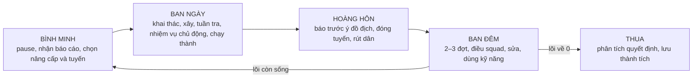

# THÀNH TRÌ — GAME DESIGN DOCUMENT v1.2

**Tên tài liệu:** `THANH_TRI_GDD_V1_2.md`  
**Phiên bản:** 1.2 — *Strategy Depth & Replayability*  
**Ngày:** 25/10/2026  
**Trạng thái:** **ĐỀ XUẤT THIẾT KẾ**, chưa phải những tính năng đã code hoặc thông số được cân bằng.  
**Nguồn đối chiếu:** `TONG_QUAN.md` (prototype, 24/10/2026), `README.md` (prototype), `THANH_TRI_GDD_V1.md` (đề xuất v1.0).  
**Định hướng đã chọn:** single-player, offline-first, RTS chiến đấu + chiến lược kinh tế sâu; căn cứ di động là cơ chế trung tâm.  
**Mục đích:** tài liệu thống nhất product/game design cho đội gameplay, UX, AI, kỹ thuật và playtest trước production.

> **Tuyên ngôn:** Thành Trì là game chiến thuật thời gian thực về **những lựa chọn không thể lấy lại**. Người chơi lãnh đạo một cộng đồng trong tòa thành chạy trên ray, xây kinh tế để nuôi quân, dùng quân để bảo vệ kinh tế, và luôn phải cân nhắc giữa **giữ những gì đã tạo ra** hay **đánh đổi chúng để tiến lên**.

---

## 0. Điều gì thay đổi từ GDD v1.0?

v1.2 **không thay đổi thể loại**; thay đổi cách các hệ thống sinh ra quyết định, cách kiểm chứng rằng game *thật sự hay*, và thứ tự phát triển để tránh phình phạm vi.

| Vấn đề phát hiện ở v1.0 | Quyết định trong v1.2 | Kết quả phải nhìn thấy khi chơi |
|---|---|---|
| Di chuyển có thể luôn tối ưu | Thiết kế **giá trị bám trụ, chi phí dời đi, nhận biết quái và độ cạn** như các lực kéo đối lập | Có ván ở lại 3 đêm hợp lý, có ván phải đi ngay; không có quy tắc cố định “ở 2 đêm rồi chạy” |
| Đêm dễ thành “đông quái hơn” | **Ý đồ địch, đội hình, mục tiêu phòng tuyến, các lần phải lựa chọn hy sinh** | Chiến thắng đến từ đổi đội và ưu tiên chứ không chỉ DPS |
| Kinh tế nhiều thao tác, ít quyết định | **Chính sách lao động + dòng hàng + rủi ro vận chuyển**; AI xử lý vi mô | Người chơi phân tích nút thắt và ra chính sách, không spam-click nông dân |
| Auto có thể thay hết người chơi | Tách **Auto-Work**, **Auto-Defend** và **Demo Bot**; đo giá trị quyết định thủ công | Người chơi ra 2–5 quyết định quan trọng mỗi trận giúp cải thiện kết quả |
| Chỉ thủ thành, lặp về lâu dài | Thêm **cơ hội chủ động ban ngày** có đánh đổi (trinh sát, cứu dân, thu hồi, đột kích nhỏ) | Trong vài ngày có lúc người chơi tự tạo lợi thế, không chỉ chờ quái đến |
| Thiếu ngõ phục hồi sau một đêm xấu | Cơ chế **khẩn cấp có trả giá**, bảo vệ tránh vòng xoáy thua không cứu được | Một sai lầm nặng vẫn có thể xoay chuyển, nhưng mất cái giá dễ hiểu |
| Mốc 6–8 phút/vòng có thể chậm | **Nhịp tăng dần**, quyết định thú vị trong 5 phút đầu; có game mode ngắn để test | Không phải chờ 20 phút để bắt đầu thấy chiến thuật |
| Nhiều cơ chế ghi bằng tính từ | Thêm **hợp đồng hành vi, quy tắc sơ bộ, tình huống, test chấp nhận** | Designer và lập trình viên có cùng tiêu chuẩn đúng/sai |

**Phạm vi của v1.2:** đặt ra thiết kế mục tiêu và thứ tự xác thực, **không** chỉ đạo viết lại toàn bộ prototype. Các con số dưới đây gắn nhãn **[GIẢ THUYẾT]** để playtest/chạy simulation; chỉ các *nguyên tắc* được coi là định hướng đã chọn.

### 0.1. Hiện trạng prototype — chỉ theo tài liệu, chưa kiểm chứng code

- Đã có vòng bình minh → ngày → hoàng hôn → đêm; tòa thành chạy trên ray; lựa chọn ở lại/đi; bỏ hoặc tháo công trình; 5 loại phòng, hai đời, 10 thẻ, hai kỹ năng; quái, địa hình, ánh sáng, save, Auto, chọn từng quân; PWA tối thiểu.
- Gỗ, đá, thực phẩm, vàng; lõi/tường/bánh xe; 4 nhóm quân (nông dân, thợ, giáo, cung), 4 nhóm địch (nhanh, trâu, bắn xa, boss).
- Vite + TypeScript strict + Three.js, `src/sim` thuần TS ở bước 60 Hz, RNG có seed, input → Command, sim → GameEvent; `src/data/balance.ts` là nơi duy nhất giữ các con số; lưu mỗi bình minh; `npm run sim` bot chạy 10 seed, tài liệu báo trung bình 6,6 đêm.
- **Chưa khẳng định** thực trạng hiệu năng, chất lượng code, mức độ vui hoặc độ ổn định của bản build vì chưa chơi và audit mã nguồn.

### 0.2. Bốn trụ cột phải bảo toàn

1. **Tòa thành di động — ở hay đi là câu hỏi khó.**
2. **Kinh tế là chuẩn bị cho chiến tranh, chiến tranh định hình kinh tế.**
3. **Thắng bằng đọc tình hình và ra quyết định đội hình**, không vì click nhanh nhất.
4. **Mỗi ván tạo một câu chuyện chiến lược khác nhau** từ seed, tuyến đường, mục tiêu và lựa chọn người chơi.

### 0.3. Các điều *không* làm trong phiên bản đầu

Không PvP, co-op, server bắt buộc, account; không factory game với 15 nguyên liệu; không diplomacy/faction simulation; không bắt micro từng nông dân; không sinh “đồ mới” chỉ để tăng menu; không có meta-upgrade cộng chỉ số vĩnh viễn. **PC-first để đạt gameplay core**, thiết kế mobile song song và chỉ phát hành cùng lúc khi UX đạt kiểm thử.

---

# PHẦN A — TRẢI NGHIỆM & VÒNG CHƠI

## 1. Tầm nhìn trải nghiệm

### 1.1. Ba tầng chiến lược

| Tầng | Quyết định | Hệ quả tiếp theo |
|---|---|---|
| **Dài hạn / hành trình** | Bám trụ, rời đi, chọn tuyến, chọn học thuyết | Địa hình, loại tài nguyên, đội hình có thể duy trì |
| **Trung hạn / kinh tế** | Chia dân, ưu tiên hàng hóa, xây module hay sửa thành | Sức phòng thủ và khả năng đi tiếp |
| **Ngắn hạn / giao tranh** | Chặn cửa nào, bảo vệ ai, đổi vị trí squad, cứu hoặc hy sinh công trình | Tổn thất nhân lực, thời gian sửa và phương án sáng mai |

**Tiêu chí chiều sâu:** một quyết định dài hạn phải có *ít nhất hai hậu quả* có thể cảm nhận được ở các tầng còn lại. Một quyết định chiến đấu tốt phải có thể bù phần nào bất lợi kinh tế mà không xóa sạch hậu quả kinh tế.

### 1.2. Ba cảm giác người chơi phải có

- **5 phút đầu:** đã ra một quyết định thật (bỏ một hạng mục để bảo vệ hạng mục khác), nhìn thấy tác dụng tức thì.
- **15 phút đầu:** nhận ra ít nhất hai chiến thuật phát triển khác nhau; chọn hướng sẽ ảnh hưởng đêm tiếp theo.
- **30 phút đầu:** thành/đội quân mang bản sắc của lối chơi; xuất hiện một tình huống “kế hoạch đổ vỡ, buộc ứng biến”.

**Không** biến các mốc này thành pop-up hướng dẫn cưỡng bức. Dùng những tình huống được sắp xếp bởi encounter director và môi trường.

## 2. “Đêm” nghĩa là gì trong Thành Trì?

**Một đêm không phải một màn độc lập.** Đây là một vòng thử thách trong **một ván liên tục**. Sống qua đêm 1 → bình minh ngày 2 → tiếp tục kinh tế, ray, quân và thiệt hại từ đêm trước. Đêm 1–3, 4–6… chỉ là **nhịp mở dần cơ chế**, không phải chia chapter cứng.



### 2.1. Nhịp mặc định mới — [GIẢ THUYẾT]

| Vòng | Ngày | Hoàng hôn | Đêm | Trải nghiệm chính |
|---|---:|---:|---:|---|
| 1–2 | 150 giây | 20 giây | 100 giây | Học kinh tế, camera, phòng thủ cơ bản |
| 3–6 | 165 giây | 25 giây | 130 giây | Chuyên môn hóa, quái khắc chế, tuyến khai thác rủi ro |
| 7+ | 180 giây | 30 giây | 150 giây | Nhiều mặt trận, chiến thuật tổn thất, boss và mục tiêu |

- Bình minh **pause không giới hạn**; có thể chọn thẻ/lệnh/route và xem báo cáo.
- **Tạm dừng chiến thuật khi đang chơi vẫn đặt lệnh**; lệnh có hiệu lực khi tiếp tục. Tránh game khó do thao tác nhanh.
- Thời lượng thực chiến mỗi vòng khoảng **4,5–6 phút** trước khi cộng thời gian pause. Không tự động kéo tất cả ngày về 8 phút như GDD v1.0.
- Một hành trình 10–12 đêm ước **45–75 phút** trước khi tính pause; cần playtest lại. **Phiên chơi thử 6 đêm** tạo trải nghiệm ngắn ~25–35 phút.
- Tốc độ x1 / x2 khi an toàn và khi đã hiểu trò chơi; không dùng x4 làm cân bằng mặc định (x4 vẫn hữu ích cho dev).

### 2.2. Thiết kế mỗi đêm theo “bài toán”, không theo lượng máu

Mỗi đêm chọn một **mẫu áp lực (pressure pattern)**, có thể kết hợp nhưng không quá tải:

| Mẫu | Điều người chơi cần làm | Dấu hiệu báo trước |
|---|---|---|
| **Đột phá** | Giữ điểm chặn, sửa tuyến chủ đạo | Bóng quái đập, hướng mũi lớn |
| **Quấy rối hậu phương** | Bảo vệ thợ, đuốc, xe hàng chưa về | Dấu hiệu nhanh ở sườn |
| **Ép phân quân** | Chia squad, quyết định bên nào hy sinh công trình | Hai mũi cảnh báo |
| **Đánh tầm xa** | Trinh sát vị trí, đưa đội cơ động phản kích | Vệt đạn thử / tiếng rít |
| **Bao vây chậm** | Điều độ sửa chữa, giữ tài nguyên cuối | Quân áp sát theo nhiều đợt |
| **Boss chuyên đề** | Đọc khả năng riêng, xử lý yếu điểm | Cảnh báo rõ loại boss và nhịp ra đòn |

Đêm đầu tập trung **một** bài toán. Từ giữa ván có **hai bài toán bổ trợ**; không ghép quá 2 kiểu khiến người mới không đọc được tình hình.

### 2.3. Quy tắc “3–5 quyết định lớn”

Ở mỗi đêm, người chơi nên có khoảng 3–5 quyết định thay đổi cục diện: đổi tuyến, chọn mục tiêu chính, dùng Mưa tên, rút về thành, bảo vệ thợ, bỏ tháp. Các thao tác nhỏ như ngắm bắn, sửa lỗ thủng thông thường, tự đứng lên tường **do AI xử lý**.

---

# PHẦN B — HÀNH TRÌNH & CĂN CỨ DI ĐỘNG

## 3. Ở lại hay đi tiếp: cơ chế độc nhất phải đủ sâu

### 3.1. Không có đáp án cố định

**Ở lại** có giá trị từ phòng tuyến đã đầu tư, hiểu địa hình và tránh mất thời gian chạy. **Đi tiếp** có giá trị từ tài nguyên, tình huống mới, điểm chặn tốt hơn và giảm áp lực bị bao vây; đồng thời mất công trình/cơ hội lao động.

| Hạng mục | Ở lại | Đi tiếp |
|---|---|---|
| Tường/tháp/đuốc đã dựng | Giữ 100% nếu còn nguyên | Bỏ hoặc tháo có giá |
| Thời gian ngày | Không mất thời gian chạy | Mất thời gian theo tải và quãng đường |
| Mỏ địa phương | Dần khó/xa hơn, ít hàng | Mỏ mới, chưa khai thác |
| Thông tin | Nắm rõ đường vào và điểm yếu | Cần trinh sát, dự báo chưa chắc |
| Quái | Ghi nhớ đường tấn công, tích áp lực | Đổi mô hình xâm nhập, có biến số vùng mới |
| Kinh tế | Tối ưu lợi ích công trình cố định | Tối ưu kinh tế cơ động, mang đi được |

**Thay đổi quan trọng so với demo:** không khóa cứng rằng “ở quá 2 đêm, tất cả ngừng hồi” thành một nút ép di chuyển tuyệt đối. Thay bằng **tài nguyên tại chỗ hữu hạn và hiệu suất giảm dần**; bám trụ lâu vẫn *có thể* sống nhờ kho, trinh sát, salvage và đầu tư đúng nhưng lợi ích giảm rõ. Điều này cần kiểm chứng để tránh exploit thủ mãi.

### 3.2. Mô hình áp lực ở lại — [GIẢ THUYẾT]

- `localDepletion` của từng điểm tài nguyên từ 0–100%; giảm bởi lượng đã khai thác, không bởi đồng hồ thuần.
- `enemyAwareness` tăng qua mỗi đêm **thực sự đóng trại tại cùng cụm điểm**, tạo thêm đường tấn công hoặc tăng độ chính xác chọn công trình yếu. Trinh sát/phản công có thể làm chậm, **không xóa vĩnh viễn**.
- `entrenchment` đến từ tường, tháp, chỗ trống được dọn và đường vận chuyển đã tối ưu; mất dần khi chuyển vùng.
- Di chuyển 1–4 ô rồi quay lại **không reset** trạng thái ở lại. Theo dõi `campNodeId` hoặc vùng liên quan, không chỉ vị trí float của thành.
- Khả năng mỏ sinh tài nguyên không tự hồi vô hạn. Nếu giữ logic hồi của prototype trong lúc thử nghiệm, buộc đặt cap hữu hạn rõ ràng.

### 3.3. Đọc quyết định bằng một thẻ route

Một thẻ của **Ở lại** hoặc **Đi tới địa điểm mới** phải hiện:

1. **Thời gian di chuyển** dự kiến (đã tính tải trọng).
2. **Nguồn hàng quan trọng** + trữ lượng / mức cạn (khoảng giá trị nếu thiếu trinh sát).
3. **Số cửa tấn công** và đặc tính địa hình.
4. **Công trình sẽ mất / tỷ lệ thu hồi** và thời gian tháo.
5. **Nguy cơ biết trước** và độ tin cậy của dự báo.
6. **Lợi thế đặc biệt** có thể chọn (mỏ, trạm tiếp tế, nhiệm vụ nhỏ).

Màn bình minh cho so sánh **3 phương án cùng lúc**: Ở lại / Nhánh A / Nhánh B. Lựa chọn không được giấu sau một chuỗi menu.

### 3.4. Đi tiếp vẫn là quá trình trong thế giới

- Chọn đích vào bình minh; **bấm Chạy** mới bắt đầu (như prototype) để còn thời gian tháo công trình.
- Khi bánh xe hỏng/thiếu điều kiện, nút Chạy giải thích lý do; không im lặng.
- Thành chỉ di chuyển ban ngày; nếu hoàng hôn đến khi chưa tới, dừng ở vị trí hiện tại và dùng môi trường thực, không teleport tới đích.
- Nếu dừng giữa đường, hệ thống cho biết đó là **trại tạm**; vẫn có đủ không gian chiến đấu hợp lệ, nhưng không mặc định là một node nghỉ an toàn.
- Không thể thay đổi nhánh đã qua sau khi đã vượt nút giao; lựa chọn có hậu quả.

## 4. Tuyến đường, địa hình, trinh sát

### 4.1. World graph và triển khai theo giai đoạn

**Bản sản phẩm mục tiêu:** mạng các đoạn ray sinh bằng seed với nhánh được lựa chọn ở bình minh; có thể quay lại một số khu vực nếu thiết kế chiến dịch yêu cầu nhưng **không** dùng để farm vô hạn.

**Prototype chiều sâu (Mốc A):** chưa cần làm graph procedural hoàn chỉnh. Dùng **2 điểm dừng pre-authored sinh theo seed** cùng một lựa chọn Ở lại; chứng minh lựa chọn tuyến đã khó rồi mới làm world graph.

### 4.2. Biome phải thay đổi cả kinh tế lẫn trận đánh

| Biome | Kinh tế | RTS / địa hình | Rủi ro dài hạn |
|---|---|---|---|
| **Đồng bằng** | Lương thực tốt, ít vật liệu cứng | Trống, nhiều hướng vào; thuận cho squad cơ động | Tốn tường bao lớn |
| **Rừng** | Gỗ nhiều, vận chuyển đường hẹp | Bị che tầm nhìn, phục kích quái nhanh | Hậu cần dễ bị quấy phá |
| **Hẻm núi** | Đá/sắt tốt, thiếu lương thực | Hai lối vào, dễ giữ nút thắt | Khó nuôi quân đông; có nguy cơ kẹt đường |
| **Bờ sông** *(P1)* | Thực phẩm, vật liệu trôi dạt | Cầu / ford là điểm nghẽn | Tùy thủy triều hoặc đường vượt |
| **Tàn tích** *(P1)* | Thu hồi sắt/vàng hiếm | Vật cản phức tạp, quái đặc biệt | Cơ hội lớn nhưng rủi ro cao |

Không được biến hẻm núi thành “biome tốt nhất”; cái giá thiếu lương thực và phương án rút lui phải thật.

### 4.3. Trinh sát là mua thông tin bằng chi phí

- Trinh sát đọc trước: độ giàu mỏ, hướng quái, điểm quan trọng, biến cố; **không** tự khai mở toàn bộ bản đồ khi miễn phí.
- Chi phí: một đơn vị rời đội, thời gian, nguy cơ trúng phục kích; có thể rút về nếu thấy nguy hiểm.
- Kết quả phải *thay đổi quyết định*: xác suất đổi route, đội hình hoặc kế hoạch kinh tế. Nếu người chơi không bao giờ trinh sát, giảm chi phí hoặc tăng thông tin có giá trị, không tăng số map icon.
- Dự báo có 3 mức: **Chưa rõ / Ước lượng / Đã xác nhận**. Không dùng độ chính xác giả kiểu 73,6%.

## 5. Tòa thành có cấu hình, tải trọng và điểm yếu

### 5.1. Những thành phần không thay

- **Lõi**: về 0 → thua.
- **Tường / vùng phòng thủ**: hấp thụ đòn trước lõi, có thể bị phá theo hướng.
- **Bánh xe**: hỏng → không chạy, sửa tốn thợ và vật liệu.
- **Phòng trong thành**: cạnh tranh ô và cộng hưởng; khởi đầu đủ công năng cơ bản.

Các chỉ số gốc demo (lõi 800, tường 700, bánh 150; đời 1 = 4 ô, đời 2 = 8 ô, tối đa 12) **chỉ dùng làm điểm baseline để thử**, không chốt cho phiên bản chính thức.

### 5.2. Tải trọng là một quyết định chiến thuật, không phải sổ kế toán

**[GIẢ THUYẾT]** Công thức có chủ đích đơn giản:

```text
usedLoad = baseStructureLoad + Σ(moduleLoad) + carriedCargoLoad + packedDeployablesLoad
loadRatio = usedLoad / loadCapacity
if loadRatio <= 1.0: moveSpeed = baseSpeed
if 1.0 < loadRatio <= 1.25: moveSpeed = baseSpeed * 0.75
if 1.25 < loadRatio <= 1.5: moveSpeed = baseSpeed * 0.50
if loadRatio > 1.5: cannot start travel; player can unload/salvage/reconfigure
```

**Dữ liệu chỉ minh họa;** không dùng trực tiếp trước khi benchmark. Trên UI: **Nhẹ / Nặng / Quá tải**, thời gian tới nơi và nguyên nhân chính. Không bắt người chơi tự cộng số.

### 5.3. Lưới phòng và cộng hưởng dễ hiểu

Đời 1 (4 ô), đời 2 (8 ô), đời 3 (12 ô) theo định hướng mở rộng từ demo; chỉ có tối đa **2 tương tác cộng hưởng trọng tâm** trong một cấu hình để tránh stack vô hạn. Các cặp mẫu:

| Hai phòng kề nhau | Hiệu ứng thiết kế | Trade-off |
|---|---|---|
| Trại lính + Xưởng thợ | Tái trang bị / gia cố đội giữ tuyến | Chiếm chỗ của kinh tế |
| Bếp + Nhà dân | Nâng hiệu suất nuôi dân/thuận lợi tuyển người | Ít ô cho quân sự |
| Trường bắn + Tháp canh | Kiểm soát tầm nhìn và đường bắn | Dễ mất sức giữ cận chiến |
| Kho + Xưởng cơ khí | Nâng trữ hàng/hiệu suất hành trình | Tăng tải và chi phí bảo trì |

Đổi vị trí phòng giữa ván có **thời gian + vật liệu**, và không thể đổi miễn phí giữa đợt quái. Mỗi cặp cộng hưởng có UI giải thích một câu.

### 5.4. Module cần thử trước

**P0:** Nhà dân, Xưởng thợ, Trại lính, Trường bắn, Tháp canh, Kho, Bếp, Xưởng cơ khí thử nghiệm.  
**P1:** Lò rèn, trạm quân y, sàn pháo, thiết bị đóng gói.  
**P2:** Module đặc biệt theo biome/boss; không đưa vào trước khi P0 đạt tiêu chí.

### 5.5. Ba học thuyết là ba *cách vận hành*, không phải skin

| Học thuyết | Cơ chế riêng | Ưu đãi | Cái giá bắt buộc |
|---|---|---|---|
| **Pháo đài** | Tăng hiệu quả khi nối các tuyến tường/phòng thủ | Giữ vị trí tốt | Công trình ngoài thành mất nhiều khi rời đi; thành nặng |
| **Đoàn hành quân** | Rút quân và thu hồi công trình linh hoạt | Trinh sát/di chuyển tốt | Không đạt mức phòng thủ cố định cao nhất |
| **Quân giới** | Chiến thắng nhờ ưu tiên mục tiêu và hỏa lực phối hợp | Hạ mục tiêu lớn tốt | Đòi hỏi sắt/thực phẩm/đạn và đội hình bảo vệ |

**Mốc A** chỉ thử **hai** học thuyết Pháo đài và Đoàn hành quân trước; chỉ thêm Quân giới khi hai lối đầu thực sự khác trải nghiệm.

---

# PHẦN C — KINH TẾ CHIỀU SÂU NHƯNG KHÔNG RỐI

## 6. Hệ thống kinh tế: chiến lược nằm ở nút thắt

### 6.1. Tài nguyên

| Tài nguyên | Dùng để | Quy tắc ưu tiên |
|---|---|---|
| **Gỗ** | Phòng cơ bản, tháp, tường, sửa nhẹ | Cần nhiều đầu ván; vùng rừng là cơ hội + rủi ro |
| **Đá** | Gia cố, đời thành, chốt phòng thủ | Càng xây thủ cố định càng tiêu hao |
| **Lương thực** | Nuôi dân/đội quân, phục hồi sau tổn thất | Cần dự báo số sáng có thể sống |
| **Vàng** | Quái/sự kiện, cứu nguy/hợp đồng đặc biệt | Hiếm, không dùng cho mọi thao tác |
| **Sắt** *(P1)* | Trang bị, động cơ, hỏa lực cao cấp | Chỉ mở khi P0 đã đủ sâu với 4 tài nguyên |

**Không** tạo thêm “gỗ tinh”, da, nước, nhiên liệu, đạn riêng ở P0. Nếu sàn pháo cần đạn khi ra mắt P1, mô phỏng chi phí từ gỗ/sắt hoặc lượt dự trữ cố định; chỉ thêm nguồn tài nguyên mới khi nó tạo quyết định riêng.

### 6.2. Hai loại việc: tạo hàng và đưa hàng về

Đường vận chuyển là phần chiến lược có thể nhìn thấy trên bản đồ, **nhưng không biến game thành simulator logistic chi li**:

```text
Worker được phân công → chọn điểm có tài nguyên → di chuyển tới → khai thác trong thời gian T
→ nhận C vật liệu (inventory cá thể/nhóm) → chọn tuyến về thành → nộp kho
→ tiếp tục theo policy; có thể bị quái chặn, chậm do đường vòng hoặc sợ nguy hiểm
```

**Quy tắc:** hàng **chỉ cộng vào kho khi nộp**. Đang cầm hàng mà worker chết / phải bỏ chạy sẽ tạo hàng rơi có thời hạn hoặc mất (phải báo rõ), không tăng kho hai lần. Đây là nguồn chiến thuật thật: để dân đi xa thu hoạch thêm hay rút trước hoàng hôn?

### 6.3. Ưu tiên AI lao động (P0)

Người chơi không kéo từng nông dân liên tục. Panel Kinh tế đặt ưu tiên theo ba mức cho **Thực phẩm / Gỗ / Đá** (Sắt xuất hiện sau) và công việc **Vận chuyển** được hệ thống tự tính từ quãng đường/khối lượng.

```text
Đầu vào: nhu cầu sáng mai + tồn kho + điểm khai thác + rủi ro đường đi + mức ưu tiên
AI: phân bổ người, lập nhiệm vụ, tái cân bằng sau khi trả hàng hoặc khi công việc không còn hợp lệ
Người chơi: có thể khóa 1–2 người vào tuyến ưu tiên; vẫn có thể cho lệnh thủ công
```

**Lệnh ưu tiên thợ:** `Khẩn cấp sửa thành` > `Chữa cháy` > `Công trình đang thi công` > `Sửa ngoại vi` theo mặc định. Override riêng luôn được ưu tiên, trừ khi lệnh không hợp lệ.

### 6.4. Công thức throughput để debug — [GIẢ THUYẾT]

Đối với điểm tài nguyên i:

```text
cycleTime_i = moveOut_i + harvest_i + moveBack_i + deposit_i
expectedRate_i ≈ assignedWorkers_i * carriedAmount_i / cycleTime_i
actualRate_i = deliveredAmount_i / elapsedSimSeconds
```

- Hiệu suất chịu ảnh hưởng bởi địa hình, tắc đường, an ninh tuyến và sức chứa, không nhân tùy ý 5 loại buff.
- UI chỉ hiển thị: **nhập thực tế/phút**, **tồn kho**, **dự báo thiếu**, **đường đang nguy hiểm**. Chi tiết chia việc mở khi người chơi muốn.
- Nếu người chơi tăng người khai thác nhưng thu nhập không tăng do vận chuyển bị nghẽn, game phải giải thích được “Nghẽn tuyến về kho”, không im lặng.

### 6.5. Lương thực — áp lực có thể dự báo

- Trước bình minh hiển thị **nhu cầu nuôi quân sáng tới** và còn nuôi được **bao nhiêu lần bình minh**.
- **[GIẢ THUYẾT]** thiếu thực phẩm lần đầu: hiệu suất phục hồi / di chuyển giảm có cảnh báo; thiếu tiếp: suy yếu mạnh hơn, nhưng **không tự trừ 30% máu cả làng một cách bất ngờ** như quy tắc thử nghiệm của demo.
- Đội quân đông có thể mạnh ban đêm nhưng đòi hỏi thực phẩm và lao động. Một nhóm mạnh nhưng thiếu ăn phải cho thấy tác động trong lựa chọn tuyến.
- Khi thiếu 1–2 lương thực để sống qua đêm, người chơi có ít nhất một phương án có trả giá: rút đội khai thác, bỏ nâng cấp, chuyển tuyến hoặc dùng dự trữ khẩn cấp (nếu đã mở).

### 6.6. Tồn kho và tải trọng: hai giới hạn khác nhau

- **Sức chứa kho** là tối đa lượng hàng có thể lưu trữ.
- **Tải trọng thành** là lượng nặng ảnh hưởng khả năng di chuyển.
- Hàng chưa nộp **không tính vào kho** nhưng vẫn tồn tại trên worker; tránh nhân đôi hoặc mất trạng thái khi save.
- UI phải giải thích “Kho đầy” khác “Thành quá tải”; cho người chơi lựa chọn xây kho, dùng hàng, để lại hoặc bỏ bớt khi cần di chuyển.

## 7. Kinh tế và quân sự phải tác động hai chiều

Ba vòng quan hệ bắt buộc trong vertical slice:

1. **Tài nguyên xa → cần hộ tống → thiếu quân giữ thành → mở nguy cơ đêm.**
2. **Xây tháp → an toàn tuyến mỏ → tốc độ thu nhập tăng → có thể nuôi nhiều quân**, nhưng tháp sẽ mất nếu chuyển thành.
3. **Đêm thiệt hại nặng → thợ sửa và gỗ ưu tiên khẩn cấp → giảm đầu tư lâu dài → phải chọn vùng an toàn hoặc đánh cược.**

Nếu một hệ thống không tạo ít nhất một quan hệ trên, giảm phạm vi trước khi mở rộng content.

### 7.1. Cơ chế ngăn vòng xoáy thua không cứu được

**Không** “cứu miễn phí” sau mỗi trận. Thay vào đó cho người chơi **chuyển tài sản này thành khả năng sống sót khác**:

- **Đóng cửa khẩn cấp** (P0): hy sinh tường ngoài / giảm khả năng khai thác để bảo vệ lõi trong thời gian ngắn.
- **Tháo bỏ để sửa** (P0): phá một công trình ngoài thành có thể tái chế một phần nguyên liệu, dùng cứu bánh xe/tường.
- **Phương án tuyến an toàn** (P1, có điều kiện): tuyến hồi phục tài nguyên ít nhưng rủi ro thấp; không xuất hiện tự động sau mọi đêm xấu.
- **Viện trợ hiếm** (P2): sự kiện cứu nguy có nợ/đánh đổi thực, không sinh ngẫu nhiên để xóa thất bại của người chơi.

Yêu cầu QA: sau đêm mất ~30–40% đội hình, **phải tồn tại một số chiến lược phục hồi trên một số seed**, nhưng không đảm bảo mọi thất bại đều cứu được.

---

# PHẦN D — RTS CÓ CHIẾN THUẬT THỰC, KHÔNG CHỈ BUFF

## 8. Cấp điều khiển và học thuyết chỉ huy

### 8.1. Squad là đơn vị ra quyết định chính

- Khoảng **2–5 squad** đang hoạt động trong vertical slice; 3–6 quân/squad ở giai đoạn đầu (theo cân bằng).
- Squad là lớp chỉ huy; đơn vị vẫn là entity có HP, di chuyển, cooldown và trạng thái riêng.
- **Chọn từng con vẫn có** như prototype; lệnh riêng ghi đè squad cho tới khi bấm “Tự động lại”.
- Xếp hàng lệnh khi pause; lệnh mới hủy lệnh cũ trừ khi có Shift/queue rõ ràng.
- **Không** bắt người chơi chia lại squad sau mỗi thương vong; đội có thể tự duy trì đội hình co giãn.

### 8.2. Lệnh cần triển khai ở P0

| Lệnh | Ý nghĩa thực tế | Hành vi AI |
|---|---|---|
| **Di chuyển** | Đi đến vị trí, tránh đường nguy hiểm theo stance | Giữ khoảng cách squad, xử lý tắc đường |
| **Giữ vị trí** | Không truy kích quá ranh giới cho phép | Chỉ đánh kẻ trong tầm, quay về đội hình sau giao tranh |
| **Bảo vệ** | Giữ quanh thợ/xe hàng/công trình/squad | Cố đánh chặn kẻ thù tiếp cận mục tiêu |
| **Tập trung mục tiêu** | Ưu tiên một mục tiêu đang nhìn thấy | Không đuổi qua vùng chết nếu không cho phép |
| **Rút lui** | Tìm đường về thành / điểm tụ | Ưu tiên sống sót, ngắt giao tranh khi có thể |
| **Tự động lại** | Bỏ lệnh riêng, quay về AI mặc định | Phục hồi vai trò và đội hình |

**Stance chỉ 3 mức:** `Giữ`, `Linh hoạt`, `Rút về`. Không đưa 10 kiểu aggression AI vào UI.

### 8.3. Các đội hình tạo hiệu ứng bằng hành vi vật lý

**Đội hình phải làm thay đổi vị trí / tiếp xúc / mục tiêu**, không chỉ +15% chỉ số:

1. **Tuyến chắn:** khiên/giáo lập mặt trước, cung thủ phía sau; quái phải vượt/chọc thủng khoảng trống để áp sát tuyến sau.
2. **Phòng thủ vòng:** bảo vệ lõi/công trình từ nhiều hướng, ít hiệu quả khi giữ một cổ chai lớn.
3. **Đội cơ động:** đội nhanh duy trì khoảng cách, có thể vòng và rút; ít khả năng chịu va chạm trực diện.

**P0 chỉ code Tuyến chắn + Phòng thủ vòng.** Đội cơ động sau khi pathfinding và UX của hai đội đầu hoạt động ổn.

### 8.4. Điều kiện cần để “đội hình” không phải trò diễn

- Vị trí entity có va chạm/cản trở ở mức vừa đủ để chắn cửa; không cho 10 quân/chục quái đứng chồng một ô.
- Quái phải chọn đánh người chắn, vòng theo ô trống, hoặc dùng kỹ năng vượt qua nếu loại quái đó có khả năng.
- Cung thủ có đường bắn và cần vị trí sáng/tầm nhìn; đội tuyến sau bị áp sát có rủi ro rõ.
- Dải mặt trước (`frontage`) giới hạn số đơn vị có thể đánh cận chiến cùng một mục tiêu ở lối hẹp; đây là nguồn chiến thuật.
- Nếu tính toán khiến 100 entity quá nặng, thay bằng soft separation và reservation cell; **không hy sinh khả năng đọc đội hình** để đổi 5 FPS.

### 8.5. Flank và địa hình — chỉ khi thể hiện rõ

**[GIẢ THUYẾT P1]** Quân bị đánh từ bên/sau khi đang giữ tuyến trước có cơ hội mất stance/đứt đội hình. **Không** thêm phép cộng sát thương khó đọc nếu game chưa có animation / facing / feedback đủ rõ.

## 9. Bảng quân, tương khắc và quyền kiểm soát chiến trường

### 9.1. Bộ quân đề xuất

| Đơn vị | Vai trò chiến thuật | Mạnh khi | Yếu khi | Phạm vi |
|---|---|---|---|---|
| **Lính giáo** | Chặn quái lao, giữ cửa | Cổ chai, phối hợp chắn | Bị bắn tầm xa, bị vòng | P0 (đã có nền demo) |
| **Cung thủ** | Gây sát thương từ tuyến sau | Có sáng và được bảo vệ | Bị áp sát, bị che tầm | P0 (đã có nền demo) |
| **Lính khiên** | Hấp thụ áp lực trước cung | Đánh trực diện, hành lang | Bị vòng / địch phá giáp | P0 mới |
| **Thợ chiến trường** | Vá lỗ thủng, cứu bánh, đặt công trình | Có lính bảo vệ | Dễ bị quái nhanh giết | P0 (dựa thợ demo) |
| **Trinh sát** | Mở thông tin, đánh quấy nhỏ | Nhiệm vụ ban ngày, góc nhìn | Quái đông, trực diện | P1 |
| **Kỵ binh / đội cơ động** | Đánh sau, giải cứu, rút | Đồng bằng, không gian rộng | Hẻm núi, quái giáo | P2 |

**Không thêm loại quân chỉ vì ngoại hình khác.** Muốn thêm phải ghi được “đội này giải bài toán mà các đội khác giải kém hơn như thế nào?”.

### 9.2. Tương khắc bằng tình huống

Ví dụ: quái lao chỉ bị giáo giữ tốt khi giáo **đứng đúng cửa**, quân khiên chống bắn xa tốt khi **đang quay đúng tuyến**, cung thủ diệt quái lớn nhanh hơn khi **giữ được tầm nhìn và được chắn**, không phải luôn mạnh hơn kẻ khác bởi chỉ số.

### 9.3. Tính sát thương ban đầu — [GIẢ THUYẾT]

Dùng số ít loại sát thương: `physical`, `piercing`, `siege`. Kháng tùy mục tiêu, **không** đặt hệ `fire/ice/poison/holy` cho P0. Tấn công thành và tường có thuộc tính `structureDamageMultiplier` rõ. Mọi phép tính duy trì tất định, ưu tiên integer/fixed-point nếu cần replay xuyên môi trường.

## 10. Quái có ý đồ và người chơi có phản ứng hợp lý

### 10.1. Đội hình địch mục tiêu

| Địch | Mục tiêu | Khắc chế tự nhiên | Tín hiệu |
|---|---|---|---|
| Nhanh | Thợ/nông dân/cung hậu tuyến | Giáo giữ chặn, đội bảo vệ | Tiếng hú, mũi nhỏ di chuyển nhanh |
| Trâu/đập | Tường và thành | Bắn tập trung, giữ cửa, thợ sửa | Bước chân nặng, biểu tượng đập |
| Bắn xa | Cung và công binh | Đội cơ động, vùng che, tầm nhìn | Loạt đạn thử trước khi dồn sát thương |
| Phá hoại *(P1)* | Đuốc, tháp, bánh xe | Bảo vệ mục tiêu, rút về | Dấu hiệu mục tiêu khi hoàng hôn |
| Bầy *(P1)* | Ép nhiều hướng | Phòng thủ vòng, bẫy | Nhiều mũi cường độ thấp |
| Chỉ huy *(P2)* | Hỗ trợ đồng loại theo cụm | Ưu tiên diệt thủ lĩnh | Biểu tượng/aura rõ |
| Boss | Kiểm tra 1 kỹ năng chiến thuật | Phản công đúng nhịp | Telegraph dễ đọc; baseline demo báo vùng ~1,6s |

### 10.2. Night Director “cam kết trước hoàng hôn”

**Mấu chốt fairness:** Director chọn `NightPlan` theo seed/biome/đêm/tình trạng thế giới **trước khi người chơi nhận cảnh báo**. Không chọn quái counter dựa trên lệnh người chơi **sau** khi đã lộ kế hoạch.

Một kế hoạch đêm gồm:

```ts
interface NightPlan {
  nightIndex: number;
  pressurePattern: 'BREACH' | 'HARASS' | 'SPLIT' | 'RANGED' | 'SIEGE' | 'BOSS';
  lanes: Array<{ laneId: string; threat: 'LOW' | 'MEDIUM' | 'HIGH' }>;
  enemyWaves: Array<{ delayTick: number; enemyCompositionId: string; entryLaneId: string }>;
  reveal: { majorThreat: string; confidence: 'ESTIMATED' | 'CONFIRMED' };
}
```

- Hoàng hôn hiển thị hướng tấn công, mức độ ít/vừa/đông và **ít nhất một dấu hiệu về mối đe dọa đặc biệt**.
- Tăng khó theo **sự phối hợp** rồi mới tăng máu/số lượng. Không sinh một đợt vượt quá ngân sách đọc trận trên mobile.
- Quái từ bóng tối phải có dấu vết hoặc thời gian tiếp cận phù hợp; không spawn sát lõi ngoài tầm nhìn.
- Boss có nhịp ra đòn, điểm yếu, dấu hiệu trước khi ra đòn; thưởng cho người chơi hiểu cơ chế hơn là chỉ DPS race.
- Quái có mục tiêu chiến thuật, nhưng không đọc tài nguyên “giấu” của người chơi để ăn gian.

### 10.3. Mẫu trận đêm đáng nhớ

**“Phá đèn — chọc thủng cánh Đông”:** Dusk báo quái phá hoại sắp đến từ Đông và đội trâu ở Bắc. Người chơi cân nhắc chuyển một squad khiên sang Đông bảo vệ đuốc hoặc giữ khiên ở Bắc. Nếu bảo vệ đuốc, cung thủ giữ khả năng bắn nhưng tường Bắc chịu nhiều tổn thất. Nếu dồn Bắc, đuốc Đông vỡ, buộc thu cung về tầm sáng thành. **Cả hai có đường thắng có trả giá.**

## 11. Auto không được xóa mất trò chơi

Tách **ba tầng tự động**, vì “AI làm thay mọi thứ” là rủi ro chiến thuật:

| Tầng | Vai trò | Mặc định |
|---|---|---|
| **Auto-Work** | Nông dân khai thác, thợ sửa, logistics | **Bật** |
| **Auto-Defend** | Đơn vị tự tấn công, giữ stance/đội hình khi không có lệnh | **Bật** |
| **Demo Bot / Auto-Play** | Tự quyết route, nâng cấp, kinh tế, đội và kỹ năng | **Chế độ riêng**, không phải mức điều khiển mặc định của người chơi |

Vẫn có thể giữ nút Auto prototype để demo/quan sát, nhưng phân biệt rõ “Tự lo việc nhỏ” và “Chơi thay tôi”.

### 11.1. Người chơi giỏi phải tạo khác biệt

Thiết lập benchmark cùng seed và cùng độ khó giữa:

- `BotBaseline`: phân bổ và phòng thủ hợp lý nhưng **không tối ưu chiến thuật**.
- `BotTactical`: biết đổi squad, dùng cửa hẹp, bảo vệ hậu cần.
- `HumanPlaytest`: người chơi sử dụng pause, đọc cảnh báo và ra 3–5 quyết định.

**Không chốt** con số chênh lệch % thắng trước khi có dữ liệu. Điều cần chứng minh: có những trận cùng kinh tế trong đó đọc chiến trường và điều đội **đảo ngược kết quả**.

---

# PHẦN E — KHẢ NĂNG CHƠI LẠI & ĐỘ CUỐN

## 12. Mục tiêu chủ động ban ngày: tạo cơ hội, không tạo việc vặt

### 12.1. Bốn mẫu nhiệm vụ (P1)

| Nhiệm vụ | Lựa chọn | Rủi ro | Phần thưởng |
|---|---|---|---|
| **Cứu người mắc kẹt** | Cử squad rời thành để cứu | Yếu phòng thủ, có thể mất quân | Thêm nhân lực hoặc thông tin đường |
| **Thu hồi toa hàng** | Điều thợ + hộ tống lấy phụ tùng | Mất thời gian khai thác | Sửa bánh / nâng máy tiết kiệm |
| **Trạm ray hỏng** | Bảo vệ công binh sửa trước khi chạy | Chậm giờ xuất phát | Mở tuyến ngắn hơn / thêm đường chọn |
| **Ổ quái trinh sát** | Đột kích ban ngày hoặc bỏ qua | Gây thương vong, hao thời gian | Làm nhẹ áp lực một đêm hoặc biết thêm hướng địch |

**Nguyên tắc:** tại một node có **tối đa 1 mục tiêu phụ chủ đạo**; không tạo daily quest bắt buộc, không spam màn hình. Một số ngày **không có nhiệm vụ** để kinh tế và tuyến phòng thủ được thở.

### 12.2. Sự kiện là “bài toán”, không phải random trừ HP

Tránh: “Đêm nay ngẫu nhiên trừ 30% máu thành”.  
Ưu tiên: “Đường ray trước mặt sắp sập: ở lại giữ phòng tuyến, bỏ 20 giây ban ngày để sửa, hoặc chấp nhận tuyến nguy hiểm khác”.

Người chơi phải thấy **2–3 cách giải quyết**, hệ quả rõ, và việc không xử lý cũng là một lựa chọn có thể hiểu được.

### 12.3. Gói biến thiên của mỗi run

Chỉ dùng **một vài biến ngẫu nhiên có kiểm soát**:

1. Biome và phân bổ tài nguyên theo seed.
2. NightPlan / tổ hợp địch theo nhịp hợp lệ.
3. Hai tuyến có lợi/nhược điểm khác nhau (tránh cả hai cùng không đủ lương thực).
4. Một vài thẻ học thuyết/cơ hội cứu nguy.
5. Mục tiêu phụ đôi khi xuất hiện, có thể bỏ qua.

Không ngẫu nhiên hóa mọi thứ cùng lúc khiến người chơi thấy thua vì may rủi.

## 13. Tiến trình trong ván, học thuyết và phần thưởng

### 13.1. Ba tầng tiến trình

- **Mỗi bình minh:** chọn 1 trong 3 thẻ, ưu tiên **thẻ thay đổi quyết định** hơn tăng chỉ số thuần.
- **Đầu hoặc giữa ván:** chọn học thuyết thành (trong vertical slice thử 2, bản đầy đủ có 3).
- **Mốc công nghệ:** khóa mở bằng module/chi phí và vị trí ô, không dựng một cây nghiên cứu đồ sộ ngay.

### 13.2. Cấu trúc thẻ theo vai trò

| Thẻ | Cơ chế | Đánh đổi |
|---|---|---|
| **Tháo nhanh** | Thợ tháo công trình trước khi chạy nhanh hơn | Sửa chậm hơn trong ngày đó |
| **Lực lượng dự bị** | Có thể triệu tập 1 đội dân quân khẩn cấp | Tốn lương thực sáng sau |
| **Chặn ngả** | Một squad giữ hẻm có khả năng cản tốt hơn | Kém cơ động khi rút |
| **Kho gọn nhẹ** | Tăng khả năng đưa hàng theo thành | Hiệu quả phòng thủ module khác giảm do chiếm ô |
| **Sửa khẩn** | Chuyển vật liệu có sẵn thành hồi bánh/tường ngay | Hao vật tư dự kiến cho đầu tư sau |
| **Ánh sáng dẫn đường** | Đuốc mở thêm khoảng cảnh báo theo tuyến | Tốn gỗ, cần bảo trì |

**Không** có thẻ tạo “sát thương +50% vĩnh viễn” như đáp án hiển nhiên. Buff số nhỏ có thể dùng để tinh chỉnh sau, không dùng làm lõi các thẻ.

### 13.3. Meta tiến trình

Qua ván mở thêm **lựa chọn ngang**: học thuyết, biến thể khởi đầu, cosmetic, scenario. **Không** bắt người chơi cày vĩnh viễn +HP/+DPS mới có thể qua đêm 12.

## 14. Chế độ chơi và điều kiện thắng

| Mode | Mục tiêu | Mục đích |
|---|---|---|
| **Hành trình** (định hướng mode chính) | Tới trạm đích, thắng trận vây sau ~10–12 đêm | Có kết thúc rõ, thiết kế pacing & boss |
| **Endless** | Sống lâu nhất, tính điểm và thử build | Giữ sức hút gốc của demo |
| **Thử thách ngắn** (P1) | 6 đêm có ràng buộc rõ và kết thúc | Dành cho phiên 25–35 phút và playtest |
| **Cùng seed** (P1) | Tạo lại world / route / NightPlan, so thành tích offline | Chia sẻ thử thách mà không cần server |

**Fail condition:** lõi về 0. Không bắt đầu một save mới sau khi thua mà xóa báo cáo; hiện rõ nguyên nhân, tài nguyên còn, squad mất, lựa chọn trước đó.  
**Victory condition Hành trình:** trạm đích đến được + sống sót trận cuối (hoặc mục tiêu đặt trước), không chỉ tự dừng ở đêm 12.

---

# PHẦN F — TÌNH HUỐNG THIẾT KẾ & NGUYÊN TẮC CÂN BẰNG

## 15. Ba ví dụ chiến thuật chứng minh “chiều sâu”

### 15.1. Chuỗi A: Quyết định di chuyển ảnh hưởng ba đêm

**Bình minh sau đêm 3:** thành có 2 tháp và một tường tốt, đang thiếu gỗ, kho thức ăn còn khoảng hai sáng.

- **Ở lại:** phòng thủ dễ nhưng mỏ gỗ xa, nguy cơ bị tập trung đánh cửa cũ.
- **Đi rừng:** lấy gỗ nhanh, nhiều che khuất, phải trả 40–60 giây di chuyển và mất tháp.
- **Đi hẻm:** dễ giữ cửa, kiếm đá, nhưng thiếu thực phẩm và có thể đói trong 2 sáng.

**Chọn rừng:** sáng 4 dùng một squad hộ tống dân khai thác; đêm 4 thiếu quân tuyến Bắc nên buộc bỏ tường ngoài. Sáng 5 người chơi có gỗ dư để nâng thành hoặc đóng nhiều tháp — lựa chọn mới đến từ hậu quả của quyết định ban đầu.  
**Yêu cầu:** cùng seed, cả lựa chọn Ở lại lẫn Rừng phải có đường chơi khả thi với cách phân bổ khác nhau; Hẻm không được chỉ là lựa chọn “ngu”.

### 15.2. Chuỗi B: Kinh tế được thắng nhờ RTS

Một mỏ đá xa có hiệu suất cao, nhưng đoàn thợ bị quái nhanh rình. Người chơi có 3 squad:

- Đưa một squad canh mỏ → lấy thêm đá cho nâng tường, nhưng đêm về quân canh thành muộn.
- Không canh mỏ → thu ít đá, nhưng quân tập trung đỡ trận quái.
- Canh một phần đường + rút sớm → đá ít hơn nhưng bảo toàn quân lẫn thợ.

Đêm đó người chơi dùng lệnh rút đúng lúc và đặt đội khiên ở lối vào. **Quyết định chiến đấu bù được một phần thiếu đá**, không cần quân mạnh số liệu.

### 15.3. Chuỗi C: Sau một đêm rất tệ vẫn có lựa chọn

Đêm 7 mất nửa tường Đông, 2 thợ bị thương, bánh xe còn ít máu. Bình minh người chơi phải chọn:

- Tháo tháp ngoài lấy nguyên liệu chữa bánh, chấp nhận mất hỏa lực.
- Ở lại một ngày, sửa thành nhưng cạn đồ ăn, chịu thêm một đợt khó.
- Dời tới tuyến có vật tư nếu đủ sửa bánh tối thiểu, mất công trình chưa tháo.

**Yêu cầu:** game hiển thị **trả giá cụ thể**. Nếu thua đêm 8, recap giải thích người chơi đã bảo vệ/hi sinh hệ thống nào, thay vì chỉ “quái quá đông”.

## 16. Cân bằng phải đo **chất lượng quyết định**, không chỉ số đêm

### 16.1. Những gì cần log local (không mặc định upload dữ liệu)

```text
runSeed, difficulty, mode, nightIndex, biome, routeChoice,
startingResources, endingResources, shortageCause,
forceComposition, squadOrders, guardTarget, structureLoss,
combatDeaths, timeToBreach, abilityUsage,
duskPlan, forecastShown, victoryOrDefeatCause, saveVersion
```

Báo cáo thiết kế có thể tổng hợp offline khi người dùng/beta tester đồng ý xuất log. Không cần backend và không mặc định thu thập từ xa.

### 16.2. Các chỉ số quyết định

| Câu hỏi | Thước đo | Khi nào coi là vấn đề |
|---|---|---|
| Có “đường chạy tối ưu” không? | Tỷ lệ chọn ở lại/nhánh A/B theo seed; win rate theo policy | Một đường thắng gần như mọi điều kiện |
| Đội hình có tạo khác biệt không? | So cùng seed, kinh tế tương đương: tactical vs baseline bot | Đổi đội hình hiếm khi thay kết quả trận |
| Kinh tế có đọc được không? | Người chơi dự báo đúng shortage và tìm ra cách xử lý | Thường xuyên thua đói bất ngờ không hiểu lý do |
| Có bị lặp sau đêm 6 không? | Phân bố pattern/route/action, khảo sát “quyết định đáng nhớ” | Các đêm sau chỉ tăng số lượng, không thay giải pháp |
| Người chơi hiểu vì sao thua không? | Interview sau trận + death report | Không chỉ ra được một quyết định cải thiện ván sau |
| Có death spiral bất công không? | Khả năng sống tiếp sau mức thiệt hại 30–40% | Sớm mất khả năng phục hồi dù có tài nguyên/cách chơi |
| Mobile có đạt chất lượng điều khiển? | Số thao tác cho 1 lệnh squad + lỗi chạm | Ra lệnh chậm/nhầm làm mất tính chiến thuật |

### 16.3. Ngưỡng playtest đề xuất — không phải số đã đạt

**Mốc A:** chạy tối thiểu **100 seed cho mỗi bot policy**, so 3 nhóm (`Hold`, `Nomad`, `Tactical`), ghi **median, P10/P90**, tỉ lệ chọn route, nguyên nhân thua. Con số là cỡ mẫu ban đầu, không chứng minh cân bằng tuyệt đối.  
**Vertical slice:** ≥12–20 buổi playtest có quan sát (gồm người mới lẫn từng chơi RTS); ghi clip sự kiện hoặc log nếu người chơi đồng ý.  
**Tiêu chí trải nghiệm quan sát:** đa số người được hỏi có thể kể ít nhất một quyết định khó trong 15 phút đầu, chỉ được ít nhất một lỗi chiến thuật cụ thể sau thất bại; cần tinh chỉnh ngưỡng sau vòng test đầu.

**Đánh giá có kiểm soát:** dùng cùng seed nhưng **đổi bot policy** để tách tác động gameplay khỏi may rủi. Kèm ít nhất một *counterexample* mỗi khi tuyên bố cơ chế tạo chiều sâu.

### 16.4. Kiểm thử chống chiến thuật thống trị

Cho bot / người chơi thử 4 chiến lược cùng nhóm seed:

1. **Stay-heavy:** bám trụ, đầu tư tháp.
2. **Travel-heavy:** di chuyển sớm, ưu tiên kho và trinh sát.
3. **Army-heavy:** ưu tiên quân đội hơn nâng thành.
4. **Hybrid-adaptive:** đổi lối theo biome và NightPlan.

Nếu Hybrid không có lý do để thích nghi, thiếu chiều sâu. Nếu một trong 1–3 luôn thắng, có khả năng đã tạo “đáp án cứng”. **Không bắt buộc** win rate bằng nhau; bản đồ và kỹ năng đúng phải làm giá trị mỗi lối đổi theo điều kiện.

---

# PHẦN G — UX, OFFLINE & KIẾN TRÚC

## 17. UI/UX: độ sâu nằm trong quyết định, không nằm trong nhiều nút

### 17.1. Ba tầng UI

- **HUD thường trực:** thời gian, đêm, 4 tài nguyên P0, nhu cầu thực phẩm sáng tới, thành lõi/tường/bánh, 2–5 squad, cảnh báo chính.
- **Panel chiến lược (mở khi muốn):** kinh tế, trạng thái lao động, module và cộng hưởng, bản đồ tuyến, dự báo chuyển vùng.
- **UI theo ngữ cảnh:** chọn squad thấy Guard/Hold/Focus/Retreat; chọn thành thấy module; chọn vùng mỏ thấy sản lượng / rủi ro.

### 17.2. Ba quy tắc UX tuyệt đối

1. **Thông tin trước quyết định:** trước khi chuyển vùng/thu hồi/nâng cấp thấy rõ chi phí, hậu quả mất công trình, thời gian.
2. **Cảnh báo gắn với giải pháp:** “Thiếu 4 thực phẩm sáng mai”, “Trung đội 2 đang giữ mỏ — 1 squad bảo vệ thành” thay vì thông báo mơ hồ.
3. **Tạm dừng vẫn điều quân:** thuận cho PC/mobile; khi unpause hệ thống thực thi Command tại tick xác định.

### 17.3. Ưu tiên cảnh báo

`Lõi nguy hiểm > Đột phá tường > Thợ/dân bị săn > Bánh hỏng trước khi chạy > Thiếu ăn > Kho đầy > Cộng hưởng chưa tối ưu`.

Không hiện quá 3 thông báo “khẩn” cùng lúc; thông tin hạng thấp phải xếp hàng, không che giao tranh.

### 17.4. PC và mobile không dùng y nguyên HUD

- **PC:** WASD/camera, chọn squad số 1–5, kéo khung chọn cá thể, chuột phải ra lệnh, Space chạy chỉ khi ban ngày, P pause, Q/E skills. Giữ binding demo nơi có thể.
- **Mobile landscape:** dải squad đủ lớn, tap chọn–tap đặt lệnh, menu lệnh 4–6 lựa chọn, 2–3 nút kỹ năng; pan/zoom và chế độ chọn tách biệt; pause dễ chạm.
- Những thao tác chiến thuật quan trọng không quá 2–3 tương tác cơ bản (chọn squad → chọn lệnh/điểm). Xác thực bằng usability test, không khẳng định trước khi test.

### 17.5. Recap sau đêm

Mỗi bình minh hiển thị **3 ý**: `Tổn thất`, `Điểm bẻ gãy`, `Quyết định ngày tới`.

Ví dụ: “Mất 1 tháp Đông và 2 lính; tuyến Đông vỡ khi squad khiên rời vị trí; thiếu 6 gỗ để sửa và 3 thức ăn cho sáng mai.”  
Recap dựa trên GameEvent thật; không để AI tự bịa “nguyên nhân”.

## 18. Offline-first và save

- Single-player gameplay, AI, generation, chiến đấu, kinh tế chạy **trên máy**, không cần backend.
- **Offline trên web chỉ đảm bảo nếu** Service Worker/asset caching lưu toàn bộ JS, WASM nếu có, mô hình, font, audio, bảng data và route app shell. PWA manifest **một mình không đủ**.
- Cache versioned; báo rõ lần đầu cần tải và cần cài/khởi chạy online để dữ liệu sẵn sàng. Test cả Chrome/Android và Safari/iOS tương ứng thiết bị mục tiêu.
- Lưu tiến trình với `saveVersion`, `seed`, `GameState` và/hoặc Command history nếu cần. Đề xuất **IndexedDB** cho save lớn và localStorage cho settings; chỉ chuyển sau khi có benchmark/save test.
- Từ demo chỉ autosave **mỗi bình minh**; bản chính thức nên thử checkpoint tại **bình minh, hoàng hôn, giữa các đợt đêm hoặc khi người chơi thoát an toàn**. Không tạo save giữa tick thiếu nhất quán.
- Save migration v1, v1.2; không cam kết giữ mọi prototype save nếu thay schema lớn, nhưng phải thông báo được.
- Leaderboard/server/cloud-save là **tùy chọn sau phát hành**, không bắt buộc để chơi.

## 19. Kiến trúc kỹ thuật mục tiêu — bảo toàn những gì prototype làm đúng

### 19.1. Không chuyển engine chỉ vì muốn làm game “chuyên nghiệp”

Tiếp tục TypeScript strict, sim thuần deterministic, Three.js render, WebAudio, Vite làm nền **cho tới khi profile chứng minh có giới hạn**. Three.js không phải nguyên nhân game nông; design và execution mới quyết định điều đó.

```text
src/
  data/               balance.ts (duy nhất chứa số cân bằng), definitions/
  sim/
    core/             GameState, RNG, Commands, Events, step, serialization
    economy/          jobs, hauling, inventory, upkeep, policies
    fortress/         modules, synergy, load, travel, repairs
    world/            rail graph, biome, resources, scouting, objectives
    combat/           squads, formation, targeting, damage, abilities
    ai/               workers, friendly squad, enemy, NightDirector, testbots
    progression/      cards, doctrine, journey, victory
  render/             Three.js, instancing, culling, VFX, camera
  input/              keyboard, mouse, touch → Command
  ui/                 HUD, dawn, route cards, recap, economy, squad controls
  audio/              WebAudio / music / telegraph
  i18n/               en.ts, vi.ts (mọi chuỗi được dịch)
  persistence/        versioned saves, offline cache adapter
  tests/              determinism, economy, AI, replay, balance benchmarks
```

Cấu trúc trên là **đích refactor dần dần**, không yêu cầu di chuyển toàn bộ source một lần.

### 19.2. Hợp đồng lệnh thử nghiệm

```ts
// Ví dụ THIẾT KẾ, không khẳng định code hiện tại đã có các type này.
type PlayerCommand =
  | { type: 'SET_LABOR_POLICY'; resource: 'FOOD' | 'WOOD' | 'STONE'; priority: 0 | 1 | 2 | 3 }
  | { type: 'SQUAD_ORDER'; squadId: string; order: TacticalOrder; queue?: boolean }
  | { type: 'PICK_ROUTE'; destinationNodeId: string | 'STAY' }
  | { type: 'START_TRAVEL' }
  | { type: 'PLACE_MODULE'; moduleId: string; slot: number }
  | { type: 'MARK_SALVAGE'; structureId: string }
  | { type: 'USE_ABILITY'; abilityId: string; target: { x: number; y: number } };

type TacticalOrder =
  | { kind: 'MOVE'; x: number; y: number }
  | { kind: 'HOLD'; x: number; y: number }
  | { kind: 'GUARD'; targetEntityId: string }
  | { kind: 'FOCUS'; targetEntityId: string }
  | { kind: 'RETREAT'; safePointId?: string }
  | { kind: 'AUTO' };
```

**Đầu vào command chỉ có hiệu lực ở tick được xác định.** Render chỉ đọc state. UI không tự thay HP/tài nguyên. `GameEvent` được emit khi: trả hàng, thiếu ăn, vỡ tường, suy yếu bánh, đánh thọc, mất squad, chọn route, hoàn thành trinh sát, hoàn thành nhiệm vụ, chọn doctrine.

### 19.3. Những invariant không được phá

1. **Determinism:** cùng seed + commands + `balanceVersion` phải cho cùng state hash cuối.
2. **Conservation:** hàng có một nguồn sinh/một nơi lưu; không duplicate khi vận chuyển, load, dismantle, cancel.
3. **Legal state:** không âm tài nguyên, quân không tồn tại hai squad, module không chiếm trùng slot.
4. **Day/night correctness:** không chạy đêm, không cấp hành động đêm cho đơn vị trú; pause không tạo tick sim.
5. **Fog & hit:** không bắn quái ngoài điều kiện quan sát nếu không có kỹ năng chuyên biệt.
6. **World graph:** seed lặp lại map và tuyến, không có node unreachable bắt buộc.
7. **Save migration:** mỗi schema cũ được support phải test read/write; reset dữ liệu dẫn xuất hợp lệ.

### 19.4. Hiệu năng phải đo bằng scenario

Benchmark tối thiểu: 30 quân, 80–100 quái, 20–30 công trình/đối tượng tương tác, vùng đèn chồng lấn, squad pathfinding và UI ngữ cảnh. **Đây là tải kiểm thử, không phải số lượng gameplay chốt.** Đo P50/P95 frame time, sim-step, memory, spikes khi thay wall/route, riêng PC và mobile. Cân nhắc Web Worker **chỉ khi** benchmark cho thấy sim gây giật luồng render.

---

# PHẦN H — ROADMAP THỰC THI

## 20. Ưu tiên để không tự giết dự án vì quá rộng

### 20.1. P0 — Gameplay Depth Prototype (mục tiêu đầu tiên)

**Không thay hết model KayKit, không viết lại engine.** Hoàn thiện 3 vòng liên kết và một trận đêm đa phương án:

1. **Ở lại vs di chuyển:** 2 node mới có ưu/nhược điểm thực, route card rõ chi phí và tài nguyên.
2. **Kinh tế:** job+hauling+policy 3 tài nguyên; lương thực dự báo; sản lượng hiện trên UI.
3. **RTS:** squad command, `Hold`, `Guard`, `Focus`, `Retreat`, 2 formation, lính khiên.
4. **Quái:** 3 NightPlan nổi bật (`BREACH`, `HARASS`, `SPLIT`), telegraph trước khi đánh.
5. **Tòa thành:** tải trọng tối giản, 2 học thuyết thử nghiệm.
6. **Recap:** log thiệt hại, nguyên nhân thủng tường, thiếu thực phẩm; thẻ chọn tuyến.
7. **Test:** deterministic, 100 seed/bot policy, 12–20 người playtest dần, performance case.

**Không nằm trong P0:** world graph đầy đủ, 12 đêm content, sắt, sàn pháo, 6 loại quân, quá nhiều sự kiện, boss mới, meta unlock lớn.

### 20.2. P1 — Vertical Slice (6 đêm)

- Một cuộc hành trình có đầu/cuối 6 đêm, **2 biome**, 2 học thuyết, 4 nhóm chiến đấu/hỗ trợ, 4–5 archetype quái và 1 trận boss nhỏ.
- Cơ hội chủ động ban ngày: **2 loại** từ bảng ở mục 12; chúng thật sự thay đổi đêm.
- Art direction riêng (stylized legible), audio telegraph, UI/HUD đủ chất lượng, mobile prototype UX thực.
- Đạt playtest “tôi đã chọn cái gì và tại sao” trước khi tăng số asset.

### 20.3. P2 — Alpha đủ nội dung

- Journey 10–12 đêm + Endless, 4–5 biome, 3 doctrine, 5–6 loại quân, 7–8 địch, 4 mục tiêu chủ động.
- Sắt và cơ khí/hỏa lực nâng cao nếu tạo bài toán mới được chứng minh.
- Công nghệ và thẻ đủ để build khác nhau; cân bằng map seed, nâng checkpoint, QA offline và UX mobile.

### 20.4. P3 — Beta / Production / Phát hành

- Playtest ngoài nhóm phát triển, cân bằng cảm giác trận, readability, performance, accessibility, save robustness.
- Nâng nhạc/animation/VFX, tutorial; đóng băng phạm vi content trước release.
- Chỉ xem xét co-op / bảng điểm online sau khi bản chơi đơn đã chứng minh giữ chân.

## 21. Backlog kỹ thuật và test chấp nhận (dùng cho agent code)

| ID | User story / hệ thống | Phụ thuộc | Điều kiện nghiệm thu |
|---|---|---|---|
| **D01** | UI so sánh Ở lại/A/B | world + dawn | Hiện ETA, công trình mất, lương thực ước tính, số cửa, mức trinh sát |
| **D02** | Tính suy giảm tài nguyên cục bộ | resource node | Không tài nguyên vô hạn; 3 đêm ở lại có tình huống vẫn hợp lý |
| **E01** | Job khai thác-vận chuyển-nộp | worker/path/inventory | Hàng không vào kho trước khi nộp; không duplicate ở cancel/save |
| **E02** | Chính sách lao động | E01 | Đổi priority ảnh hưởng thu nhập nhưng không vi phạm giới hạn người |
| **E03** | Dự báo thức ăn | upkeep | Sai lệch giải thích được, không có penalty bất ngờ |
| **F01** | Squad membership & commands | current selection | Điều 2–5 đội; lệnh cá thể không vỡ lệnh đội; Auto lại đúng |
| **F02** | Hold/Guard/Retreat/Focus | F01 + grid | Guard phản ứng khi mục tiêu bị đánh; Hold không kéo ra quá xa |
| **F03** | Formation tuyến và vòng | F01+movement | Quân có vị trí, tương tác chắn hợp lệ, không dồn vào 1 ô |
| **N01** | NightPlan pre-commit | difficulty + seed | Cùng seed cùng plan; thay lệnh khi dusk không đổi spawn thành counter vô lý |
| **N02** | Dusk telegraph | N01 | Người chơi biết hướng, mức, đe dọa đặc biệt trước khi xuất hiện |
| **C01** | Tải trọng thành | modules+travel | Cùng build có ETA chính xác; quá tải có nguyên nhân và giải pháp |
| **P01** | Hai học thuyết | C01+F03 | Hai build chơi khác cách, đều có chi phí rõ |
| **U01** | Recap đêm | GameEvent | Nói được mất gì, ở đâu, nguyên nhân chính theo event; không tự bịa |
| **Q01** | Seed/replay/save determinism | all sim | Hash bằng nhau khi chạy thẳng và khi lưu-tải ở checkpoint |
| **Q02** | Test chiến lược Hold/Nomad/Hybrid | all P0 | Xuất report phân phối 100+ seed/policy; có counterexample |
| **Q03** | Offline cache | render/assets/save | Có thể mở game khi tắt mạng sau lần tải đầy đủ; các scene chính không đòi network |

**Thứ tự code khuyến nghị:** Q01 instrumentation → E01/E02/E03 → F01/F02/F03 → D01/D02 → N01/N02 → C01/P01 → U01/Q02 → playtest → art polishing. Có thể làm song song UI và sim nếu Command/Event schema chốt sớm.

### 21.1. Definition of Done cho mọi tính năng gameplay

Một story chỉ hoàn thành khi có: **(1)** mô tả chiến thuật tạo ra, **(2)** interface Command/Event hoặc data config, **(3)** unit/integration tests và deterministic case, **(4)** HUD feedback để hiểu hệ quả, **(5)** đo ít nhất một tiêu chí playtest/simulation. Không thêm tính năng chỉ vì code chạy.

## 22. Rủi ro và phương án cắt phạm vi

| Rủi ro | Dấu hiệu | Cách xử lý trước khi thêm nhân lực |
|---|---|---|
| Game trở thành logistic simulator | Người chơi xem slider nhiều hơn bản đồ | Gộp thao tác, tự động hóa chuyển hàng, giữ 3 resource P0 |
| RTS nông dù có squad | Formation chỉ là +buff, bot và người gần như ngang nhau | Làm thật vật cản/frontage/guard/retreat, giảm số loại quân |
| Chuyển vùng luôn thắng | Route A/B hiếm khi khác, Ở lại bị bỏ qua | Điều chỉnh chi phí chạy, lợi thế phòng tuyến, độ cạn, không ép đất kiệt quá sớm |
| Ván lặp sau đêm 6 | Chỉ tăng HP/số quái | Thêm pressure pattern và objective có hệ quả, không thêm địch chỉ để đông |
| Người chơi thua mà không hiểu | Không có event/recap hoặc UI cảnh báo | Ưu tiên telemetry, dusk reveal, báo thiếu tài nguyên |
| Quá nặng trên mobile | Pathfinding/spawn lag, UI nhỏ | Giới hạn squads, soft formation, render batching, UX riêng; PC-first nếu cần |
| Scope quá rộng | Chưa P0 vui đã làm 10 biome/20 unit | Đóng băng P1/P2; ship slice chỉ khi test đạt |
| Autosave mất ván | Mất tiến trình khi reload/crash | Snapshot nhất quán và versioning, resume offline |

---

# PHỤ LỤC

## A. Dữ liệu khởi điểm để balance — không chốt

Các số trong bảng là **khởi tạo mô phỏng**, không thay được playtest:

| Nhóm | Đề xuất thử | Nguồn / chú ý |
|---|---|---|
| Tick | 60 Hz | Giữ prototype |
| Tòa thành | Lõi/tường/bánh theo baseline 800/700/150 | Có trong tài liệu prototype; xem lại khi đổi squad/giáp |
| Tầm quân | ~10–30 entity | Baseline demo; squad 2–5 nhóm |
| Quái cùng lúc | Baseline 80 | Chỉ tăng nếu benchmark đủ |
| Ban ngày đầu | 150s | Đủ tạo ít nhất 1 trade-off |
| Hoàng hôn đầu | 20s | Báo sớm và rõ |
| Ban đêm đầu | 100s | Pacing cần human test |
| Khi tháo công trình | Baseline hoàn 30% | Từ demo; có thể đổi theo doctrine |
| Chọn học thuyết | Khoảng sau đêm 2–3 | Khởi tạo hypothesis; đừng đợi 30 phút mới khác build |
| Số đêm mục tiêu Journey | 10–12 | Chỉ chọn khi test 6 đêm đã vui |

Mọi con số dùng thật phải chuyển vào **`src/data/balance.ts`**, không hardcode trong simulation. UI display phải đi qua `en.ts`/`vi.ts`.

## B. Ma trận kiểm thử quan trọng nhất

| Case | Cấu hình | Kết quả bắt buộc |
|---|---|---|
| Bám trụ ở Hẻm | Ít thực phẩm, cửa hẹp, nhiều tháp | Thủ tốt nhưng thiếu ăn gây quyết định khó |
| Di chuyển từ Rừng | Nhiều gỗ, nhiều công trình ngoài | Tháo/thả công trình là quyết định có giá trị |
| Hộ tống mỏ | Quái nhanh ban ngày | Quân bảo vệ tạo khác biệt kinh tế có thể đo |
| Thủ nhiều hướng | Hai squad + một cửa yếu | Đổi squad đúng lúc đảo kết quả trận |
| Địch phá sáng | Đèn/đuốc là nguồn quan sát | Mất đuốc buộc đổi bố trí cung nhưng có telegraph |
| Lương thực thiếu | Kho gần 0 trước dawn | UI đã cảnh báo, có đường xử lý có chi phí |
| Bánh xe hỏng | Đã chọn đi tới tuyến xa | Không đi được; UI báo cần sửa; không softlock |
| Quá tải thành | Kho và module nặng | ETA tăng đúng, cho dỡ hàng hoặc build lại |
| Save giữa ván | Snapshot sau command+event | Không mất hàng đang chuyển hoặc thay NightPlan |
| Auto/điều quân riêng | Auto Bot on + select units | Lệnh thủ công hiệu lực, không bị Auto ghi đè vô lý |

## C. Câu hỏi còn mở — phải xác thực, không tự ý chốt bằng code

1. P0 dùng **squads đúng nghĩa** hay mở rộng hệ nhóm từ demo? Nên chọn theo cảm giác điều khiển và ngân sách pathfinding.
2. Hauling thực thể vật lý từng worker hay gộp nhóm? Cần thử cả hai phiên bản chi phí thấp.
3. Mức “bám trụ ba đêm” nên khả thi ở bao nhiêu seed? Chưa chốt tỉ lệ.
4. Có cần thêm tài nguyên **Sắt** không, hay chỉ thêm công nghệ sử dụng Gỗ/Đá/Vàng?
5. Chế độ ngắn 6 đêm có phát hành chính thức không, hay chỉ dùng để playtest?
6. Khi trưởng thành, quái “nhớ phòng tuyến” tới đâu để không biến AI thành đối thủ ăn gian?
7. Cần dành bao nhiêu budget cho game feel/animation sau khi hoàn thiện chiến thuật P0?
8. Điều kiện phát hành mobile: thiết bị mục tiêu, khung hình, cách pause và kích cỡ nút cần đo thật.

## D. Nguyên tắc ra quyết định khi tranh luận thiết kế

Tính năng mới chỉ được ưu tiên nếu trả lời **Có** ít nhất một câu:

1. Nó tạo ra một **lựa chọn có đánh đổi** mà người chơi hiểu được không?
2. Nó khiến **kinh tế, trận đánh, hành trình** tác động lẫn nhau rõ hơn không?
3. Nó khiến người chơi **đọc trận, ra lệnh, học từ thất bại** tốt hơn không?
4. Nó cải thiện **pacing, readability, điều khiển hoặc cảm giác phản hồi** rõ rệt không?

Nếu không, hoãn dù tính năng nghe hấp dẫn hoặc có asset đẹp.

---

## Một câu để toàn đội cùng giữ hướng

> **“Trong Thành Trì, chiến thắng không thuộc về người xây nhiều nhất, mà thuộc về người chọn đúng thứ cần giữ, đúng thứ phải bỏ và đúng lúc phải lên đường.”**

**Trạng thái tài liệu:** GDD v1.2 đề xuất phục vụ pre-production; bước bắt buộc kế tiếp là **P0 gameplay depth prototype + đo/playtest**, không phải sản xuất toàn bộ content từ bản thảo này.
