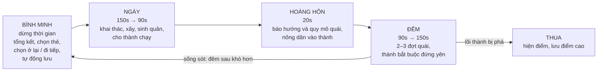
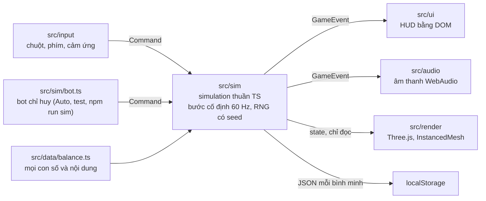

# Thành Trì: tóm tắt ý tưởng và lối chơi

Cập nhật: 24/10/2026 · Repo: https://github.com/hieudeptrai196/thanhtriver2

Thành Trì là game RTS sinh tồn chống quái trên trình duyệt (PC và điện thoại xoay ngang). Người chơi chỉ huy một ngôi
làng sống quanh **một tòa thành biết chạy trên đường ray**. Ban ngày phát triển, ban đêm cố thủ. Game chơi vô tận và
tính điểm bằng số đêm sống sót.

Bản hiện tại là **demo chơi được**, dùng để kiểm tra độ vui trước khi đầu tư tiếp. Tài liệu này giúp người mới vào nắm
được ý tưởng cốt lõi, lối chơi, những gì đã làm và cách code được tổ chức.

---

## 1. Ý tưởng cốt lõi

Điểm khác biệt duy nhất của game: **căn cứ của bạn di chuyển được**. Mỗi sáng người chơi phải đánh đổi giữa việc giữ
chỗ đã phòng thủ kỹ và việc dời đi tìm tài nguyên mới.

Toàn bộ thiết kế phục vụ đúng **hai mục tiêu**. Tính năng nào không phục vụ hai mục tiêu này thì để sau.

1. **Mỗi sáng người chơi thật sự phân vân giữa "ở lại" và "đi tiếp".**
2. **Ban đêm căng nhưng không rối.**

Các quyết định đã chốt:

| Câu hỏi | Quyết định |
| --- | --- |
| Thể loại | RTS sinh tồn chống quái, chơi đơn (PvE) |
| Cấu trúc | Vô tận, không chia màn; điểm chính là số đêm sống sót |
| Căn cứ | Một tòa thành duy nhất: nơi nộp tài nguyên, sinh quân, xây phòng, lên đời |
| Di chuyển | Thành chỉ chạy được ban ngày; ban đêm bắt buộc đứng yên |
| Nhân vật riêng | Không có. Người chơi ra lệnh cho nhóm quân hoặc từng con; quân rảnh tự làm việc mặc định |
| Nền tảng | Trình duyệt, PC và điện thoại (xoay ngang); tiếng Việt mặc định, có tiếng Anh |
| Chưa làm | Co-op, PvP, server, tài khoản |

---

## 2. Vòng chơi một ngày đêm

- Thời lượng thay đổi tuyến tính từ đêm 1 tới đêm 10 rồi giữ nguyên. Một vòng ngày đêm mất khoảng 4–5 phút.
- Đêm chia 2 đợt (đêm 1–2) hoặc 3 đợt (từ đêm 3), giữa các đợt có quãng nghỉ khoảng 12 giây.
- Mục tiêu cân bằng: người mới sống được 4–6 đêm, người khá 10–12 đêm. Bot tự chơi hiện sống trung bình 6,6 đêm.

---

## 3. Quyết định mỗi sáng: ở lại hay đi tiếp

Mỗi bình minh có ba lựa chọn: **Ở lại**, hoặc tới **một trong 2 điểm dừng phía trước** trên đường ray.

| | Ở lại | Đi tiếp |
| --- | --- | --- |
| Lợi | Giữ tường, tháp, đuốc đã xây; không mất thời gian ban ngày; đã biết địa hình | Tài nguyên đầy; có thể gặp địa hình dễ thủ (hẻm núi chỉ 2 lối vào); đêm đầu ở vùng mới quái tới tối đa 2 hướng |
| Hại | Tài nguyên cạn dần; đêm sau quái đánh **thêm 1 hướng** ("quái quen đường"); ở quá 2 đêm thì **đất kiệt**, tài nguyên ngừng hồi | Bỏ lại mọi công trình ngoài thành (thợ tháo kịp thì được hoàn 30%); mất 30–60 giây ban ngày để chạy |

Thông tin trên mỗi thẻ lựa chọn: địa hình, tài nguyên chính, số hướng quái, mức nguy hiểm (1–5), lượng tài nguyên còn
lại (với "Ở lại"), thời gian chạy (với "Đi tiếp"). Khi đất đã kiệt hoặc tài nguyên còn dưới 25%, thẻ "Ở lại" hiện
cảnh báo đỏ.

Áp lực "phải đi" đến từ ba nguồn: số hướng tấn công tăng, tài nguyên tại chỗ cạn (đứng yên mãi thì khoảng đêm 6–7 là
hết sạch), và lương thực (mỗi quân ăn 1 lương thực mỗi sáng; thiếu thì cả làng mất 30% máu).

---

## 4. Ban đêm: căng mà không rối

| Nguyên tắc | Cách game làm |
| --- | --- |
| Biết trước | Lúc hoàng hôn, mũi tên ở mép màn hình chỉ hướng quái, kèm chữ "đông" hoặc "ít" |
| Quân tự lo việc nhỏ | Lính tự đánh trong tầm; cung thủ tự lên sàn thành; thợ tự sửa chỗ hỏng nặng nhất và tự dập lửa |
| Ít quyết định mà nặng | Mỗi đêm khoảng 3–5 quyết định lớn: dồn quân hướng nào, dùng kỹ năng lúc nào, bỏ chỗ nào |
| Có nhịp thở | 2–3 đợt, nghỉ khoảng 12 giây giữa các đợt |
| Nút cứu nguy | Kỹ năng thành: **Mưa tên** (sát thương vùng, hồi 60s), **Chuông triệu tập** (mọi quân về thành, hồi 20% máu, hồi 90s) |
| Tạm dừng vẫn ra lệnh | Có, nhất là trên điện thoại |
| Báo động | Tường thành sắp vỡ, tường đã vỡ, lõi dưới 30%, cháy mái |

**Tầm nhìn ban đêm:** màn hình tối. Chỉ thấy và chỉ bắn được quái nằm trong vùng sáng (quanh thành, đuốc, tháp tên,
phòng tháp canh). Đặt đuốc ở đâu vì thế là một quyết định chiến thuật.

**Độ khó:**
- Số quái mỗi đêm khoảng `20 × 1,25^(đêm − 1)`. Tối đa 80 quái sống cùng lúc; phần vượt được bù bằng quái trâu máu hơn.
- Số hướng tấn công: 2 (đêm 1–2), 3 (đêm 3–6), 4 (từ đêm 7). Ở lại thì +1; vùng mới thì tối đa 2; địa hình giới hạn
  thêm (hẻm núi chỉ 2).
- Vùng càng xa thì tài nguyên càng nhiều và quái càng mạnh (+6% mỗi đoạn đường).

---

## 5. Các hệ thống

### Tòa thành

- Có **lõi** (800 máu; về 0 là thua), **tường thành** (700 máu, đỡ đòn trước khi tới lõi) và **bánh xe** (150 máu;
  hỏng thì không chạy được tới khi thợ sửa xong).
- Là nơi duy nhất nộp tài nguyên, sinh quân, xây phòng và lên đời. Ban đêm nông dân vào thành trú.
- **Lưới ô phòng:** đời 1 có 4 ô, đời 2 có 8 ô; thẻ "+1 ô" mở thêm, tối đa 12. Lên đời 2 tốn 200 gỗ, 100 đá, 50 vàng.

| Phòng | Chi phí | Tác dụng |
| --- | --- | --- |
| Nhà dân | 40 gỗ | +3 giới hạn dân, sinh nông dân |
| Trại lính | 60 gỗ, 20 đá | Sinh lính giáo |
| Trường bắn (đời 2) | 60 gỗ | Sinh cung thủ |
| Xưởng thợ | 50 gỗ | Sinh thợ, mở khoá công trình ngoài thành |
| Tháp canh | 40 gỗ, 30 đá | Vùng sáng lớn hơn ban đêm, tự bắn tên |

**Cộng hưởng** (hai phòng đặt kề cạnh nhau trong lưới): Trại lính cạnh Xưởng thợ thì lính giáo +15% máu; Tháp canh
cạnh Trường bắn thì cung thủ +20% tầm.

### Công trình ngoài thành

Thợ xây; chỉ xây được khi thành đang đứng yên và đã có Xưởng thợ.

| Công trình | Chi phí | Tác dụng |
| --- | --- | --- |
| Tường gỗ | 10 gỗ | Chặn đường; quái phải đập hoặc đi vòng (tường ngắn thì đi vòng, tường dài thì đập) |
| Tháp tên | 40 gỗ, 15 đá | Tự bắn quái trong vùng sáng |
| Đuốc | 8 gỗ | Tạo vùng sáng |

### Quân

Quy mô khoảng 10–30 đơn vị; giới hạn dân là 10 cộng 3 cho mỗi Nhà dân. Quân chết là mất hẳn. Khởi đầu với 4 nông dân,
1 thợ, 3 lính giáo, phòng Nhà dân và Xưởng thợ.

| Nhóm | Lệnh | Tự làm khi rảnh |
| --- | --- | --- |
| Nông dân | Cắm cờ khai thác; về thành | Khai thác chỗ gần nhất còn trữ lượng, ưu tiên loại tài nguyên đang thiếu trong kho; đêm thì vào thành |
| Thợ | Xây; sửa (ưu tiên); tháo | Dập lửa, xây bản vẽ, tháo chỗ đã đánh dấu, rồi sửa thứ hỏng nặng nhất (tường thành, bánh xe, công trình) |
| Lính giáo | Tập trung / giữ vị trí | Canh phía quái sẽ tới; ban ngày đuổi quái lẻ trong bán kính 18 quanh thành |
| Cung thủ | Tập trung | Đứng trên sàn thành (được cộng tầm bắn) |

### Quái

| Loại | Từ đêm | Hành vi |
| --- | --- | --- |
| Quái nhanh | 1 | Nhắm nông dân và thợ; ban ngày có vài con lẻ (từ ngày 2) |
| Quái trâu | 1 | Đập tường, công trình, tòa thành |
| Quái bắn xa | 3 | Đứng xa bắn quân |
| Boss | 5, 10, 15… | Rất trâu; đập diện rộng có vòng đỏ báo trước khoảng 1,6 giây |

Quái tìm đường bằng "bản đồ khoảng cách" tới thành (flow field); tường làm đường đắt hơn chứ không chặn hẳn.

### Tài nguyên, thẻ, sự kiện

- **Gỗ** (cây), **đá** (mỏ), **lương thực** (bụi quả): có trữ lượng hữu hạn. **Vàng**: rơi từ quái và boss.
- **Thẻ nâng cấp** (mỗi sáng chọn 1 trong 3, có 10 loại): lính +20% máu, tháp bắn nhanh +25%, thành chạy nhanh gấp đôi,
  nông dân mang +50%, đuốc sáng rộng +30%, tường và công trình bền +30%, xây và sửa nhanh gấp đôi, +1 ô phòng,
  cung thủ +25% sát thương, hồi 40% lõi.
- **Sự kiện:** cháy mái ban đêm (từ đêm 2, xác suất 45%; thợ phải dập, nếu không lõi mất máu dần); người lạ xin gia
  nhập ban ngày (50%; thêm 1 nông dân và 1 lính giáo nếu còn chỗ).

### Thế giới

Một con đường ray thẳng, dài vô tận, chia thành các đoạn 48 ô, sinh theo seed (cùng seed thì ra cùng thế giới).

| Địa hình | Tài nguyên | Phòng thủ |
| --- | --- | --- |
| Đồng bằng | Nhiều lương thực | Quái tới từ 4 hướng |
| Rừng | Nhiều gỗ | 4 hướng |
| Hẻm núi | Ít, chủ yếu đá | Vách núi hai bên, chỉ 2 hướng vào, dễ thủ |

### Điểm và lưu

- Điểm = số đêm × 100 + số quái hạ + số boss × 500. Bảng điểm cao lưu trên máy.
- Tự lưu mỗi bình minh vào localStorage; menu có "Chơi tiếp".

---

## 6. Điều khiển

Ngoài lệnh theo nhóm, người chơi có thể **chọn từng con kiểu Đế Chế** để chỉnh chỗ cần đông người hơn: quân được chọn
nhận lệnh riêng, dàn đội hình quanh điểm đích, và trở về việc tự động khi bấm "Tự động lại". Nút **Auto** cho AI chơi
thay toàn bộ để người chơi quan sát; vẫn chọn quân tay được trong lúc Auto.

| Thao tác | PC | Điện thoại (xoay ngang) |
| --- | --- | --- |
| Camera | WASD / mũi tên / kéo chuột giữa; lăn chuột để phóng to | Kéo một ngón; chụm hai ngón |
| Chọn nhóm | Phím 1–4 hoặc thanh nhóm | Chạm thanh nhóm |
| Chọn từng con | Kéo chuột trái quét khung; bấm vào một con; Shift để chọn thêm | Nút "Chọn" rồi kéo khung; chạm vào một con |
| Ra lệnh | Chuột phải vào vị trí | Chạm vị trí sau khi chọn |
| Ô phòng | Bấm vào thành / Tab | Chạm thành / nút Thành |
| Xây ngoài thành | B | Nút Xây (chạm xem trước, chạm lần nữa để đặt) |
| Chạy / Dừng (chỉ ban ngày) | Space | Nút Chạy |
| Gọi tất cả về | H | Nút Gọi về |
| Kỹ năng | Q Mưa tên, E Chuông triệu tập | Nút kỹ năng |
| Auto | O | Nút Auto |
| Tạm dừng | P / Esc | Nút tạm dừng |

---

## 7. Bản demo đã có gì, còn thiếu gì so với thiết kế

**Đã có và chơi được:** trọn vòng ngày, hoàng hôn, đêm, bình minh lặp vô tận; quyết định ở lại hay đi tiếp kèm cơ chế
đất kiệt; thành chạy trên ray, công trình bị bỏ lại hoặc hoàn 30%; 5 phòng có cộng hưởng; đời 1–2; 10 thẻ; 2 kỹ năng;
2 sự kiện; 4 loại quái kèm boss; 3 địa hình; ánh sáng và tầm nhìn ban đêm; lưu và chơi tiếp; điểm cao; tiếng Việt và
tiếng Anh; PC và cảm ứng; chế độ Auto; chọn quân kiểu Đế Chế; đồ hoạ KayKit; cài được lên màn hình chính (PWA).

**Có trong tài liệu thiết kế nhưng chưa làm:**

| Mảng | Chưa làm |
| --- | --- |
| Tòa thành | Đời 3 (12 ô, lò rèn cấp 2); phòng Lò rèn, Kho, Bếp; kỵ binh; kỹ năng thứ 3 "Đuốc lớn" |
| Quái | Quái kéo người (đêm 6), quái phá công trình (đêm 8), quái bay hoặc đào (đêm 11); boss đêm 10 gọi thêm quái |
| Địa hình | Ven sông, làng bỏ hoang, đất chết |
| Sự kiện | Thùng tiếp tế, dân gặp nạn, gãy bánh xe ban đêm, đêm dài |
| Ở lại | Công trình xuống cấp 15% mỗi đêm nếu không sửa |
| Tiến trình | Dùng điểm để mở khoá thẻ, phòng, quân và điều kiện khởi đầu giữa các ván |
| Điều khiển | Cuộn camera khi đưa chuột ra mép màn hình |

---

## 8. Kỹ thuật và cách phát triển tiếp

**Công nghệ:** Vite, TypeScript (strict), Three.js. Không dùng game engine. Site tĩnh, deploy được lên Vercel.

| Thư mục / file | Vai trò |
| --- | --- |
| `src/sim/` | Luật chơi. Không import DOM hay Three.js. Nhận mảng `Command`, phát ra `GameEvent`. Cùng seed và cùng chuỗi lệnh thì ra cùng kết quả |
| `src/sim/sim.ts` | Vòng lặp chính: pha ngày đêm, AI quân, quái, chiến đấu, xây, lưu |
| `src/sim/grid.ts` | Lưới điều hướng 80×80 ô quanh thành; A* có cache cho quân; flow field cho quái |
| `src/sim/world.ts` | Sinh các đoạn đường và tài nguyên theo seed |
| `src/data/balance.ts` | **File duy nhất chứa mọi con số** để chỉnh cân bằng |
| `src/render/` | Vẽ bằng Three.js; model KayKit được "nướng" thành vài khung hình tĩnh để vẽ hàng loạt |
| `src/ui/`, `src/input/`, `src/i18n/` | HUD, điều khiển, chữ hiển thị (`en.ts` định nghĩa khoá, `vi.ts` phải đủ mọi khoá) |
| `public/models/` | Model KayKit đã cắt gọn (CC0, Kay Lousberg; xem `CREDITS.md`) |

**Lệnh hay dùng:**

| Lệnh | Việc |
| --- | --- |
| `npm install && npm run dev` | Chạy bản phát triển |
| `npm run check` | Typecheck, lint, 33 test, build; phải xanh trước khi đẩy code |
| `npm run sim` | Bot tự chơi 10 seed, in số đêm trung bình (mục tiêu 5–8, hiện 6,6) |
| `?speed=4`, `?seed=123`, `?fps=1`, `?lang=en` | Tham số URL để thử nhanh, cố định seed, xem FPS, đổi ngôn ngữ |

**Quy ước khi làm tiếp:**
- Mọi con số mới cho vào `src/data/balance.ts`; không viết chữ hiển thị trực tiếp trong code (thêm khoá vào `en.ts` và
  `vi.ts`).
- Giữ simulation tất định: chỉ dùng RNG trong state, không dùng `Math.random` hay thời gian thực trong `src/sim/`.
- Đổi luật chơi thì chạy `npm run sim` để xem cân bằng còn nằm trong 5–8 đêm không.
- Các quyết định đã tự đưa ra khi đặc tả để ngỏ được ghi trong mục "Quyết định tự đưa ra" của `README.md`.
