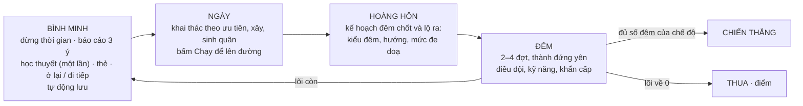

# Thành Trì: tóm tắt ý tưởng và lối chơi

Cập nhật: 25/10/2026 · Repo: https://github.com/hieudeptrai196/thanhtriver2 · Thiết kế mục tiêu:
[THANH_TRI_GDD_V1_2.md](THANH_TRI_GDD_V1_2.md)

Thành Trì là game RTS sinh tồn chống quái trên trình duyệt (PC trước, điện thoại xoay ngang song song). Người chơi
lãnh đạo một ngôi làng sống quanh **một tòa thành chạy trên đường ray**: ban ngày xây kinh tế, ban đêm cố thủ, và mỗi
sáng chọn giữ những gì đã xây hay đánh đổi để đi tiếp. Bản hiện tại là **prototype P0 của GDD v1.2**: đủ các vòng
liên kết để chơi thử và đo, chưa phải nội dung đầy đủ.

> "Chiến thắng không thuộc về người xây nhiều nhất, mà thuộc về người chọn đúng thứ cần giữ, đúng thứ phải bỏ và đúng
> lúc phải lên đường."

---

## 1. Ý tưởng cốt lõi

Bốn trụ cột (GDD v1.2 §0.2):

1. **Tòa thành di động:** ở hay đi là câu hỏi khó, không có đáp án cố định.
2. **Kinh tế chuẩn bị cho chiến tranh, chiến tranh định hình kinh tế.**
3. **Thắng bằng đọc tình hình và điều đội**, không phải bằng click nhanh.
4. **Mỗi ván là một câu chuyện khác** nhờ seed, tuyến đường, kiểu đêm và lựa chọn của người chơi.

| Câu hỏi | Quyết định |
| --- | --- |
| Thể loại | RTS sinh tồn chống quái, chơi đơn, offline |
| Chế độ | **Hành trình** 12 đêm có đích (chế độ chính), **Thử thách ngắn** 6 đêm, **Vô tận** |
| Điều khiển | Không có anh hùng. Quân tự lo việc nhỏ; người chơi đặt ưu tiên kinh tế, điều đội, chọn từng con khi cần |
| Không làm ở bản đầu | PvP, co-op, server, tài khoản, nâng chỉ số vĩnh viễn, kinh tế 15 loại nguyên liệu |

---

## 2. Vòng chơi

| Giai đoạn | Ngày | Hoàng hôn | Đêm |
| --- | --- | --- | --- |
| Đêm 1–2 | 150 giây | 20 giây | 100 giây |
| Đêm 3–6 | 165 giây | 25 giây | 130 giây |
| Đêm 7+ | 180 giây | 30 giây | 150 giây |

Tạm dừng vẫn ra lệnh được; có tốc độ x2. Một vòng ngày đêm khoảng 4,5–6 phút.

---

## 3. Ở lại hay đi tiếp

Mỗi bình minh có 3 phương án đặt cạnh nhau: **Ở lại**, **điểm dừng thứ 1**, **điểm dừng thứ 2**. Mỗi thẻ hiện địa
hình, tài nguyên chính, lượng tài nguyên còn lại, số hướng quái, mức nguy hiểm, và thời gian chạy (đã tính tải trọng).

| | Ở lại | Đi tiếp |
| --- | --- | --- |
| Được | Giữ tường, tháp, đuốc; không mất thời gian | Tài nguyên đầy; có thể gặp hẻm núi dễ thủ; đêm đầu ở vùng mới tối đa 2 hướng |
| Mất | Tài nguyên **hữu hạn, không hồi**; đêm sau **thêm 1 hướng**; từ đêm thứ 3 ở cùng chỗ, mỗi đêm thêm **12% quái** (quái nhận biết trại) | Bỏ công trình (thợ tháo kịp thì hoàn 30%); mất thời gian chạy; thành nặng thì chạy chậm, quá tải thì không chạy được |

Bot đo được: lối chơi thích nghi (Chiến thuật) không thua hai lối cứng nhắc; chi tiết ở mục 8.

---

## 4. Ban đêm: căng mà không rối

**Kế hoạch đêm chốt trước** lúc hoàng hôn, theo seed và tình trạng thế giới; người chơi làm gì sau đó cũng không đổi.
Đêm 1–2 có một bài toán, từ đêm 3 ghép hai:

| Kiểu | Bài toán | Người chơi cần làm |
| --- | --- | --- |
| Đột phá | 60% quân dồn một hướng, nhiều quái trâu | Giữ chặt cửa đó |
| Quấy rối | Quái nhanh đánh sườn, săn thợ, nông dân, đuốc, tháp | Bảo vệ hoặc rút họ vào |
| Gọng kìm | Hai hướng ngược nhau, đông ngang nhau | Chia đội hoặc chọn bỏ một phía |
| Mưa đạn (từ đêm 3) | 40% quái bắn xa | Khiên đứng trước, đội cơ động đánh vào |
| Bao vây (từ đêm 4) | 4 đợt nhỏ liên tiếp | Điều độ sửa chữa, giữ gỗ |
| Boss | Đêm 5, 10 và đêm cuối của hành trình | Né vòng đỏ báo trước 1,6 giây |

- Hoàng hôn hiện băng "Đêm nay: …" kèm gợi ý, mũi tên mỗi hướng ghi **ít / vừa / đông**. Dự báo là **ước lượng**
  (khoảng số quái), có phòng Tháp canh thì thành **xác nhận**.
- Số quái khoảng `20 × 1,25^(đêm − 1)`, tối đa 80 sống cùng lúc. Số hướng: 2 (đêm 1–2), 3 (đêm 3–6), 4 (đêm 7+).
- Chỉ thấy và bắn được quái trong vùng sáng (thành, đuốc, tháp).
- **Khẩn cấp có trả giá:** Đóng cửa (mỗi đêm một lần: tường +35%, giảm nửa sát thương 20 giây; công trình ngoài mất
  40% máu, thợ và nông dân ở trong tới sáng). Thẻ mở thêm Dân quân và Sửa khẩn.
- **Báo cáo bình minh 3 ý:** Tổn thất; Điểm bẻ gãy (vỡ tường ở hướng nào, cháy mái, thợ bị bắt); Ngày tới cần gì.

---

## 5. Các hệ thống

### Tòa thành

- Lõi 800 (về 0 là thua), tường thành 700 (đỡ đòn trước), bánh xe 150 (hỏng thì không chạy được).
- **Tải trọng:** phòng và hàng trong kho làm thành nặng. Nhẹ / Nặng (chậm 25%) / Rất nặng (chậm 50%) / Quá tải (không
  chạy được, có nút bỏ bớt hàng). Kho tăng sức chở.
- **Kho chứa:** tối đa 300 mỗi loại, +250 mỗi phòng Kho; giao vượt mức là mất.
- **Lưới phòng:** đời 1 có 4 ô, đời 2 có 8 ô (200 gỗ, 100 đá, 50 vàng), tối đa 12.

| Phòng | Chi phí | Tác dụng |
| --- | --- | --- |
| Nhà dân | 40 gỗ | +3 dân, sinh nông dân |
| Trại lính | 60 gỗ, 20 đá | Sinh lính giáo và lính khiên |
| Trường bắn (đời 2) | 60 gỗ | Sinh cung thủ |
| Xưởng thợ | 50 gỗ | Sinh thợ, mở công trình ngoài thành |
| Tháp canh | 40 gỗ, 30 đá | Sáng rộng, tự bắn, xác nhận dự báo đêm |
| Kho | 50 gỗ | +250 chứa mỗi loại, +25 sức chở |
| Bếp | 40 gỗ | Cả làng ăn ít đi 25% |

Cộng hưởng (kề cạnh): Trại lính + Xưởng thợ → lính giáo +15% máu; Tháp canh + Trường bắn → cung thủ +20% tầm;
Bếp + Nhà dân → sinh nông dân nhanh hơn 30%; Kho + Xưởng thợ → công trình ngoài rẻ hơn 15%.

**Học thuyết** (chọn một lần, sau đêm 2):

| | Được | Mất |
| --- | --- | --- |
| Pháo đài | Công trình +40% máu, tháp +25% sát thương, tường +20% | Thành nặng hơn 25%, chậm 15%, tháo chỉ hoàn một nửa |
| Đoàn hành quân | Tháo nhanh gấp đôi, hoàn gấp đôi, sức chở +40%, nhanh 25% | Công trình −25% máu, tháp −15%, tường −10% |

### Kinh tế

- Gỗ (cây), đá (mỏ), lương thực (ruộng bí ngô, lúa mì, ngô): hữu hạn, không hồi. Vàng: rơi từ quái.
- **Bảng Kinh tế** (K): ưu tiên Tắt/Thấp/Vừa/Cao cho Lương thực, Gỗ, Đá. AI tự chia nông dân theo ưu tiên, nhu cầu
  (lương thực x2 khi dưới 2 sáng) và tồn kho. Hiện sản lượng mỗi phút, số người làm, lượng còn quanh trại.
- Hàng chỉ cộng vào kho khi **nộp**. Nông dân chết khi đang vác thì hàng rơi tại chỗ, nhặt lại được trong 120 giây.
- Mỗi sáng mỗi người ăn 1 lương thực (có Bếp thì ít hơn). Thanh trên hiện **"đủ N sáng"**. Thiếu lần đầu: cả làng
  yếu đi (chậm, đánh yếu 20%); thiếu lần hai liên tiếp: yếu 40% và một người bỏ đi.
- **Sửa chữa tốn gỗ** (0,05 gỗ mỗi máu). Thợ ưu tiên: sửa tường khẩn cấp (dưới 35%) > dập lửa > xây > sửa ngoài.

### Quân và chỉ huy

| Quân | Vai trò |
| --- | --- |
| Nông dân | Khai thác, vác về; ban đêm vào thành |
| Thợ | Xây, sửa, tháo, dập lửa |
| Lính giáo | Chặn cửa, đánh cận chiến |
| Lính khiên | Máu 190, đỡ nửa sát thương tên bắn, **không bị đẩy lùi**: chắn đường quái |
| Cung thủ | Bắn từ tuyến sau, cần vùng sáng; đứng trên sàn thành được cộng tầm |

- **Đội 1–5:** lính mới tự vào đội mặc định (giáo 1, khiên 2, cung 3); phím số chọn đội, Ctrl+số gán.
- **Lệnh:** Di chuyển (linh hoạt), Giữ vị trí (không đuổi), Bảo vệ (một quân, công trình hoặc thành), Tập trung (một
  con quái; chuột phải vào quái), Rút lui (về thành, không đánh), Tự động lại.
- **Đội hình:** Tuyến chắn (khiên, giáo trước; cung sau 1,8 ô) hoặc Vòng tròn.
- **Chắn đường thật:** quân cản quái; mỗi quân chỉ bị tối đa 3 quái cận chiến đánh cùng lúc, nên cửa hẹp có giá trị.
- **Sát thương:** thường / xuyên (tên) / công thành (quái trâu, boss).

### Quái

| Loại | Từ đêm | Hành vi |
| --- | --- | --- |
| Quái nhanh | 1 | Săn nông dân và thợ; trong Quấy rối thì săn cả đuốc và tháp |
| Quái trâu | 1 | Đập tường, công trình, tòa thành |
| Quái bắn xa | 3 | Bắn quân từ xa (khiên đỡ được) |
| Boss | 5, 10, đêm cuối | Đập diện rộng có báo trước |

### Thẻ (mỗi bình minh chọn 1 trong 3, thẻ nào cũng có giá)

Lính cứng cáp, Cung nhanh, Trục bôi mỡ, Gùi lớn, Ánh sáng dẫn đường, Tường dày, Tháo nhanh, Cánh thành mới,
Tên có ngạnh, Vá lõi (chỉ khi lõi dưới 70%), Lực lượng dự bị (mở Dân quân), Chặn ngả, Kho gọn nhẹ, Sửa khẩn (mở kỹ
năng). Ví dụ: "Cung nhanh: tháp bắn nhanh 25% · tháp tốn thêm 10 gỗ".

### Thế giới

Đường ray thẳng vô tận, chia đoạn 48 ô, sinh theo seed. Đồng bằng (nhiều lương thực, 4 hướng), Rừng (nhiều gỗ),
Hẻm núi (ít tài nguyên, chỉ 2 hướng vào). Càng xa càng giàu và càng nguy hiểm.

### Điểm và lưu

Điểm = đêm × 100 + quái hạ + boss × 500 (+1000 khi hoàn thành chế độ). Tự lưu mỗi bình minh; bảng điểm cao ghi chế độ.

---

## 6. Điều khiển và chế độ tự động

- Việc nhỏ quân luôn tự lo (tương ứng Auto-Work và Auto-Defend của GDD, luôn bật).
- **AI chơi thay** (O) là bot trình diễn riêng: tự chọn tuyến, thẻ, học thuyết, xây, sinh quân, dùng kỹ năng.
- Phím đầy đủ xem `README.md`. Trên điện thoại mọi thao tác có nút; màn dưới 1100px thì nút chỉ hiện biểu tượng.

---

## 7. Đồ hoạ

Tòa thành là "đoàn tàu pháo đài" (bánh tàu, thanh truyền, ống khói nhả khói khi chạy). Đêm có ánh trăng xanh, vùng
sáng ấm, đuốc bập bùng; giao tranh có tên bay, chớp sáng khi trúng đòn, xác ngã. Giao diện cố tình ít chữ: biểu
tượng và số, giải thích nằm trong tooltip. KayKit (Kay Lousberg) cho nhân vật, quái, thành, tháp, cây, đá, đồi núi; Kenney Nature Kit cho cỏ, hoa, nấm, ruộng;
địa hình low-poly liền mạch, đường ray, đuốc dựng bằng code; bóng đổ mặt trời tự tắt khi máy yếu. Hoạt ảnh được
"nướng" thành vài khung hình tĩnh để vẽ hàng loạt. Ghi công đầy đủ: [CREDITS.md](../CREDITS.md).

---

## 8. Hiện trạng và việc tiếp theo

**Đã có (P0 của GDD v1.2):** mọi mục ở trên, cộng hash trạng thái, log mỗi đêm (`history`, xuất file ở màn kết
thúc), 3 bot policy (bot Chiến thuật biết dàn tuyến khiên), báo nghẽn đường về kho, điểm lưu lúc bình minh và hoàng
hôn, chơi offline (Service Worker), lưu cũ vẫn tải được, 50 test.

**Số đo gần nhất** (`npm run sim -- --seeds 8`): trung vị Bám trụ 7 đêm, Du mục 6, Chiến thuật 7. Ba lối vẫn sát
nhau; GDD §16.4 yêu cầu chạy 100 seed mỗi policy và playtest có quan sát để chỉnh tiếp.

**Chưa làm (P1 trở đi):** world graph có nhánh, trinh sát và độ tin cậy dự báo theo trinh sát, nhiệm vụ chủ động ban
ngày, biome Bờ sông và Tàn tích, sắt, kỵ binh và trinh sát viên, học thuyết Quân giới, checkpoint giữa đêm, IndexedDB,
playtest 12–20 buổi.

---

## 9. Kỹ thuật

| Thư mục / file | Vai trò |
| --- | --- |
| `src/sim/` | Luật chơi thuần TS, bước 60 Hz, RNG có seed, tất định; nhận `Command`, phát `GameEvent` |
| `src/data/balance.ts` | **File duy nhất chứa mọi con số** |
| `src/sim/bot.ts` | 3 bot policy cho đo cân bằng và AI chơi thay |
| `src/render/` | Three.js: `terrain.ts`, `models.ts`, `renderer.ts` |
| `src/ui/`, `src/input/`, `src/i18n/` | HUD, điều khiển, chữ (`vi.ts` phải đủ mọi khoá của `en.ts`) |
| `public/models/`, `public/sw.js` | Model đã cắt gọn; Service Worker offline |

Quy ước: số mới vào `balance.ts`; chữ mới vào `en.ts` và `vi.ts`; không dùng `Math.random` hay thời gian thực trong
`src/sim/`; đổi luật thì chạy `npm run check` và `npm run sim`; mỗi tính năng phải có Command/Event, test, phản hồi
trên HUD và một số đo (GDD §21.1).
